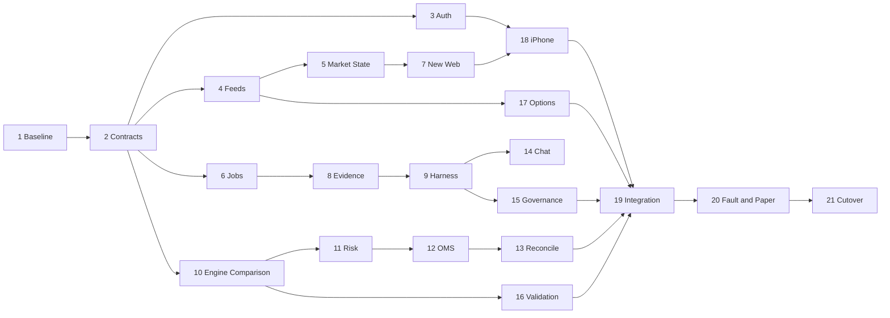

# GabFin 架構重建與升級 Implementation Plan

> **For agentic workers:** 按 [GabFin skill workflow](../../agents/workflow.md) 逐單位實作與審查；現有 Superpowers 技能按需支援。下列 checkbox 是待辦，不代表已執行。不得因本文件存在就開始安裝產品依賴、交易或部署。

**Goal:** 建立可在桌面及 iPhone 使用、具備可追溯研究與多空股票 paper 執行的個人交易工作台。

**Architecture:** 前端全面重寫；後端選擇性重建，以明確契約分隔行情、研究 harness、策略、風控、委託及帳本。先在本機使用少量隔離程序；移植有價值的測試及領域邏輯，驗證後替換舊流程。

**Tech Stack:** 提案為 React／TypeScript／Vite、FastAPI／Pydantic、SQLite WAL、Parquet、LangGraph、OpenD 行情 adapter、Alpaca paper adapter；LEAN 是回測比較首候選。確切版本經相容性 spike 後鎖定。

**Spec:** [需求及完整架構設計](../specs/2026-11-25-gabfin-system-design.md)。其中 U 是已確認需求，P 是工程提案，G 是啟用關卡，E 是證據。

## Global Constraints

- 初始 paper 本金 **US$100,000**，不是實際資產；本期不接真倉。
- 股票支援做多、做空、日內、持有數週及盤前／正常／盤後；第一版期權只做行情與研究。
- **沒有全球最多兩天限制，也不要求日內標籤當天強制清倉。**
- **不固定單筆風險 1%。** 動態止損／倉位必須受已批准的可配置限額約束。
- **40% 是帳戶回撤驗收上限。** 日虧、單筆、曝險、槓桿與 runtime halt 數值不可自行冒充已批准。
- 聊天僅查帳戶、分析清單、啟動研究及產生 advisory 方案；所有交易控制工具禁用。
- 不以 ADR-003 或其他舊決策作設計約束；不使用 Claude-Mem。
- 每月基礎 HK$400，期權資料可評估約 HK$100 加額；任何實際購買另呈現具體方案。
- 本機 Windows 開發，所需運行時段保持開機；iPhone PWA 透過私人 HTTPS，交易在主機運行。
- 本文件不授權修改 GitHub、推送、合併、真倉、採購或開設帳戶；這些按各自授權與關卡執行。

## Review Focus

1. 同一 symbol 日內與波段的相反意圖、部分成交及重啟：不能多下單或以子帳本掩蓋真實淨持倉。Task 12、13、19。
2. 來源晚到／修訂、夏令時間及盤前盤後：不能前視或用非交易 session 下錯訂單。Task 5、10、16。
3. iPhone 鎖屏、網絡切換、過期 session 與代理 loopback：不能誤授權、重播寫入或顯示假新鮮。Task 3、7、18。
4. 錯誤／惡意新聞、聊天或研究 artifact：不能取得券商 capability、偽造引用或自動部署政策。Task 8、9、14、15。
5. 不可借股票、broker 502、資料中斷及耗盡模型預算：停止受影響新入場，但對帳與保護仍運行。Task 6、11、12、20。

## 1. 執行前狀態與本計劃的完成定義

2026-11-25 main 基準為 `42f96b3b8a39e40f2e4e579aa9e619814dc80e7b`。
本機工作區目前沒有 application checkout；只有 AGENTS 及文件。本次只完成規劃，沒有跑應用測試／實測行情／量測延遲。

本次文件完成 = 需求追溯、架構、契約、任務、驗收、回退及待批准項已寫入並自查。
產品第一版完成 = 本計劃 mandatory tasks 通過，U01–U21 有證據，且所有啟用關卡完成；不得將中途里程碑稱為完整第一版。

### 1.1 範圍拆分與依賴



Tasks 3/4/6/10 在 Task 2 契約凍結後可獨立工作；是否使用開發子 Agent 留待執行方式選擇，不自動多開昂貴上下文。
Task 22 是開發工具比較，可以延後，不阻塞產品；Task 23 是安全／效能關卡，必須在 Task 20 正式 paper 前完成。
Task 24 是記憶與交付，隨每個里程碑維護，在第一版收尾再次驗證。
完整整合 Task 19 還須完成 3、5、7、9、11–18；正式 paper Task 20 必須先通過 Task 23。Task 21 只能在 20 驗收後切換。

## 2. 統一契約與責任邊界

全部 Python types 放在 `services/gabfin/contracts/`，以 Pydantic schema 產生 TypeScript contracts，不手寫另一套欄位。
ID 使用 UUID；金額／價格／數量 Decimal，JSON 用字串；比例統一 0..1，UI 明確格式化。日期為含 offset 的 UTC ISO8601。

| 契約／檔案 | 必要欄位 | 使用者與生產者 |
|---|---|---|
| `Instrument`／`market.py` | instrument_id、asset_class、vendor_symbols、currency、tick_size、lot_size、option expiry/right/strike/multiplier | symbol resolver → 其他模組；期權不能只用股票 ticker。 |
| `MarketEvent`／`events.py` | schema_version、event_id、instrument_id、event_at、received_at、available_at、source、source_seq、dedup_key、kind、typed payload | provider → market；source_seq 為可空字串，dedup key 不可空；quote/trade/bar discriminator，來源／instrument／bar 時間與 payload 一致。 |
| `QuoteSnapshot`／`market.py` | instrument_id、as_of、bid/ask/last 各自 price/event/received/available time/age、feed、session、quality、entitlements | cache → API／風控；缺值保持 None。quote event 是完整觀察快照，原始 delta 先合併，不把 None 當 unchanged。 |
| `Bar`／`market.py` | instrument_id、source、timeframe、session、start/end、OHLCV、forming/final/corrected、revision、corporate_action_policy、event/received/available time | market → chart／strategy；保留公司行動政策標籤，不在契約層執行調整。 |
| `EvidenceItem`／`research.py` | evidence_id、url、publisher、original_firm、published_at、first_seen_at、available_at、content_hash、license_tag | evidence service → Agent。 |
| `CandidateObservation`／`research.py` | instrument、reason、source evidence、horizon、observed_at、expires_at、action | discovery → universe history。 |
| `ResearchRequest`／`research.py` | instruments、question、horizon、actor、capability_scope、snapshot_id、budget_id | API／scheduler → harness。 |
| `ResearchReport`／`research.py` | request_id、facts、inferences、citations、missing_data、as_of、model/prompt version、usage | harness → UI／archive。 |
| `TradePlan`／`intent.py` | advisory=true、instrument、side(long/short)、entry/exit scenarios、evidence、as_of | chat/research → UI；不是 executor 輸入。 |
| `StrategyIntent`／`intent.py` | intent_id、strategy_version、policy_version、instrument、side(long/short)、position_effect(open/reduce/close)、setup、invalidation、expires_at、snapshot_id、producer_scope | 策略 → risk；不由 chat principal 產生。方向／倉位動作分離為使用者在 S02/02a 的確認；本層不轉成券商委託。 |
| `PolicyVersion`／`policy.py` | version、allowed strategies/sessions/assets、risk bounds、approval_hash、approved_at、status | governance → risk；缺關鍵數值 status=DRAFT。 |
| `RiskDecision`／`policy.py` | approved、reason_codes、quantity、risk_amount、checks、policy_version、expires_at | risk → OMS；禁止 LLM 寫 approved=true。 |
| `OrderCommand`／`order.py` | client_order_id、intent_id、instrument、side(buy/sell)、qty、type、limit_price、TIF、session、risk_decision_id | executor → broker adapter；由策略方向與倉位動作、帳戶上下文轉換。 |
| `OrderEvent`／`order.py` | broker id、client id、status、cum_fill_qty、fill_price/evidence、event time、dedup key | broker → ledger；缺成交證據不補 fill。 |
| `HarnessProposal`／`policy.py` | artifact hash、base/deploy version、diff、experiment ids、metrics、rollback version、approval | research lab → governance。 |

### 2.1 核心介面

```python
class FeedAdapter(Protocol):
    async def capabilities(self) -> FeedCapabilities: ...
    async def subscribe(self, keys: list[SubscriptionKey]) -> None: ...
    async def unsubscribe(self, keys: list[SubscriptionKey]) -> None: ...
    def events(self) -> AsyncIterator[MarketEvent]: ...

class ResearchRunner(Protocol):
    async def run(self, request: ResearchRequest) -> ResearchReport: ...

class BrokerAdapter(Protocol):
    async def submit(self, command: OrderCommand) -> SubmitResult: ...
    async def lookup(self, client_order_id: str) -> OrderSnapshot | None: ...
    async def reconcile(self) -> BrokerSnapshot: ...

class RiskService(Protocol):
    def evaluate(self, intent: StrategyIntent, context: RiskContext) -> RiskDecision: ...

class Strategy(Protocol):
    def evaluate(self, context: StrategyContext) -> list[StrategyIntent]: ...
```

`SubmitResult` 含 ACKNOWLEDGED/REJECTED/UNKNOWN，不以 exception 一律當拒單。`RiskContext` 含帳戶、已預留風險、pending orders、借券狀態、quote quality、session 及政策快照。

支援模型也由 Task 2 定義，避免後續任務各自發明：
- `FeedCapabilities`：source、asset_classes、sessions、latency_label、max_subscriptions、history_limits、checked_at、permission_errors。
- `SubscriptionKey`：instrument_id、channel、timeframe；`Demand` 再帶 priority、owner、expires_at；`SubscriptionPlan` 分 accepted/rejected/reasons。
- `Principal`：actor_id、role、scope；`Capability` 為顯式 enum；`Resource`：kind、id、owner。
- `StrategyContext`：as_of、finalized_bars、features、account_snapshot_id、strategy_version、policy_version；不可包含未來 bar。
- `BrokerSnapshot`：account、positions、open_orders、recent_fills、as_of、complete；`ReconciliationResult`：matched、mismatches、entry_allowed。
- `JobLease`：job_id、worker_id、lease_token、expires_at、attempt；`Reservation`：budget_id、job_id、amount、currency、status。
- `ModelRequest/Result`：request_id、model、schema、messages/evidence_refs、deadline／output、usage、cost_state、error。
- `ExperimentSpec/Result`：strategy_version、dataset_manifest、time_range、session_policy、execution_assumptions／events、fills、equity、fees、warnings。
- `HealthReport`：component、heartbeat_at、state、last_error_code、lag_ms、dependency_health；所有 enum／models 出現在同一 schema artifact。

### 2.2 資料表與交易邊界

Task 2 建 `schema_migrations`、`instruments`、`events`、`job_runs`、`job_leases`、`artifacts`。
後續 migrations 建 `candidate_observations`、`universe_snapshots`、`evidence`、`research_reports`、`strategy_versions`、`policy_versions`、`approvals`、`intents`、`risk_reservations`、`orders`、`fills`、`outbox`、`reconciliation_runs`、`audit_events`。
`events` 存重要領域事件，不同步落盤所有行情 ticks。Quote 最新值在 cache，研究／決策時封存所用 snapshot。
order/client key、fill dedup key、intent consumption、proposal approval hash 有 unique constraint。
DB transaction 不跨網絡；snapshot／policy 的版本不可在同一決策中混用。

## 3. 可獨立驗收的任務

每個程式任務：先建立具體失敗案例，確認失敗原因，再實作、通過指定測試及必要既有 regression。下列測試名稱與 assert 是最低驗收，不要求照抄實作。
文件／baseline 任務不寫形式化單元測試。每個 task 完成只 commit 自己的 paths；不使用 `git add .` 混入使用者修改，不自動 push。

### Task 1 — 固定 source、建立可重現基線

**Files:** Create `docs/audit/baseline-2026-11-25.md`、`docs/audit/module-inventory.md`；保留既有 AGENTS 與本規劃。
**Interfaces:** 輸出 source SHA、dirty diff 清單、功能矩陣、測試／build 真實結果、外部呼叫清單。

- [ ] 取得舊 repo 的隔離 checkout；若當前工作區已有修改，另建子目錄或 worktree，不能覆蓋本地文件。
- [ ] 讀取 checkout 內適用指令；使用者新需求優先，舊 ADR 不當產品決策來源。
- [ ] 在隔離 venv 執行 `python -m pytest`，記錄 pass/fail/skip 與環境；測試不得使用真倉憑證。
- [ ] 依 lockfile／manifest 跑舊前端 build，記錄工具版本與失敗；沒有 lockfile 如實記錄。
- [ ] 盤點真正 route→service→provider→store 路徑；每項功能標可用、部分、實驗、未知。
- [ ] 以 `git diff --check` 核對文件；commit message `docs: establish reproducible legacy baseline`。

**驗收:** 應用程式可被獨立重現；不沿用歷史「368 passed」當目前結果。不因 baseline 失敗宣稱 migration 完成。

### Task 2 — 領域契約、套件及遷移基礎

**Files:** Create `pyproject.toml`、`services/gabfin/contracts/{events,market,research,intent,order,policy}.py`、`services/gabfin/storage/{database,migrations}.py`、`tests/gabfin/test_contracts.py`、`tests/gabfin/test_migrations.py`。
**Interfaces:** 本計劃 §2 全部契約；`migrate(db_path: Path) -> SchemaVersion`；`open_database(path: Path) -> Connection`。

- [x] 測試 `test_money_roundtrip_exact`：Decimal("0.10") 序列化後精確還原；`test_timezone_required` 拒絕 naive timestamp；`test_trade_plan_never_executable` 不能 cast 成 StrategyIntent。
- [x] Run `python -m pytest tests/gabfin/test_contracts.py tests/gabfin/test_migrations.py -q`，確認新契約未實作時失敗。
- [x] 定義 package discovery 為 `services/gabfin`，隔離新命名空間；初始 migration 可重跑、可辨識未知 schema。
- [x] 產生前端 JSON schema artifact；測試 `test_schema_generated_from_python` 檢查產物與模型版本一致。
- [x] 安裝本地 editable package 後重跑；migration crash case 不可留下半套 schema。
- [x] Commit `feat: introduce versioned domain contracts and storage`。

### Task 3 — 明確身份、session 及能力授權

**Files:** Create `services/gabfin/api/{auth,sessions,capabilities}.py`、`tests/gabfin/security/test_auth.py`。
**Interfaces:** `authorize(principal: Principal, capability: Capability, resource: Resource) -> None`；`issue_session(pairing_code: str) -> Session`。

- [x] 測試 `test_loopback_is_not_operator`、`test_ws_rejects_foreign_origin`、`test_expired_session_cannot_write`、`test_pairing_code_single_use`。
- [x] Run `python -m pytest tests/gabfin/security/test_auth.py -q`，確認權限案例失敗。
- [x] 實作短效一次配對及 server session；owner、chat、research、executor 使用不同 principal／capability。
- [x] 寫入需 CSRF／Origin；URL query 不接受永久 token；拒絕訊息不洩漏秘密。
- [x] 重跑；測試代理傳入 loopback 及偽造 forwarded headers 仍需 session。
- [x] Commit `feat: enforce explicit sessions and service capabilities`。

### Task 4 — OpenD 及行情能力探測

**Files:** Create `services/gabfin/providers/futu/{adapter,capabilities,symbols}.py`、`services/gabfin/market/subscriptions.py`、`tests/gabfin/market/test_feed_capabilities.py`、`docs/audit/feed-entitlements.md`。
**Interfaces:** `FeedAdapter`；`plan_subscriptions(demands: list[Demand], caps: FeedCapabilities) -> SubscriptionPlan`。

- [x] Fake adapter 測試：持倉優先、相同訂閱去重、離頁 unsubscribe、超額時有 reason、股票／期權 instrument 不混淆。
- [x] Catalog／planner 的公開測試先 RED 後 GREEN；實際路徑為 `tests/gabfin/test_symbols.py`、`tests/gabfin/test_subscription_planner.py`，證據見 03f 報告。
- [x] 移植舊 symbol／quota 邏輯中可驗證部分；OpenD SDK 隔離程序，只開行情 context，不 unlock trade。
- [ ] 在擁有者主機做最小 smoke：一股 quote、bar、指定期權 chain／quote、PRE/POST 能力；記時間、權限及配額，不記帳號。
- [x] 能力不足時輸出具體 G2 缺口及成本候選，不能偷偷改資料源標籤。
- [x] 本機提交 capability-aware adapter／planner；03f、03g 及收尾提交見 S03 報告。

### Task 5 — 真正推送、Bar Builder、新鮮度與重播

**Files:** Create `services/gabfin/market/{coordinator,bars,freshness,replay,stream}.py`、`tests/gabfin/market/test_stream_replay.py`。
**Interfaces:** `apply(event: MarketEvent) -> list[MarketUpdate]`；`snapshot(keys) -> MarketSnapshot`；`entry_eligible(snapshot, policy, now) -> FreshnessDecision`。

- [x] 測試 duplicate tick 不增加 volume、late tick 修訂正確 bar、DST／休市 session、斷線補缺、無新成交但 heartbeat 健康。
- [x] Bar／freshness／coordinator／stream 公開行為先 RED 後 GREEN；實際測試位於 `tests/gabfin/test_{bar_builder,freshness,market_coordinator,internal_market_stream}.py`，證據見 S03 報告。
- [x] 以 provider callback 推送到有界 queue，不再用 15 秒 snapshot 假裝即時。
- [ ] 接通真實 history adapter，歷史 REST 只作初始化及補缺；本次交付可驗證的 recovery seam，真實接入與補缺證據留在 [G2 票](../../tickets/s03-stream/issues/03-feed-evidence-g2.md)。
- [x] 跨程序初期採 loopback authenticated internal stream，由單一市場程序服務；驗證 scope、不得公開監聽，版本不相容立即拒絕。
- [x] quotes 可合併最新值；行情通道拒絕委託，slow consumer 斷線後要求 snapshot，禁止無限 queue。
- [ ] 委託事件不可丟棄；此傳遞保證由 S08 OMS／交易事件通道驗證，行情通道拒收不是委託交付證據。保留原要求。
- [ ] 重跑並記 event→receive→state→UI tracing；commit `feat: deliver replayable market events and freshness`。

S03 工程收尾於 2026-11-26 完成；[交付／驗證／界線](../../audit/s03-completion-2026-11-26.md)。
Task 4 的完整 realtime／BBO／PRE／POST 證據仍屬 G2 open gate，不能勾成通過。
Task 5 已完成 source→receive→state→consumer 實測及本機提交 1802198；
UI render tracing 續接 S04，最後一項尚未完整驗收。既有確認需求沒有刪除。

### Task 6 — 持久化任務、取消及模型費用帳本

**Files:** Create `services/gabfin/research/{jobs,budget,worker}.py`、`tests/gabfin/research/test_jobs_budget.py`。
**Interfaces:** `enqueue(request) -> JobId`；`claim(worker_id, now) -> JobLease | None`；`reserve_budget(job_id, estimate) -> Reservation`；`cancel(job_id, actor) -> JobState`。

- [ ] 測試同 key 不重複 job、lease crash 後恢復、取消不再呼叫模型、月預算以實際＋保留額拒絕超額工作。
- [ ] Run `python -m pytest tests/gabfin/research/test_jobs_budget.py -q`，確認失敗。
- [ ] 實作短 DB transaction claim、heartbeat、attempt counter、deadline；一個 task 錯誤不讓整個 worker 假成功。
- [ ] `LLMClient.complete(request: ModelRequest) -> ModelResult` 統一 usage、schema、timeout、價格版本；不吞掉錯誤成空報告。
- [ ] 重跑；測試 provider timeout 後費用未知記 unknown，不當零元。
- [ ] Commit `feat: add durable research jobs and bounded model spend`。

### Task 7 — 全新桌面前端與圖表縱向切片

**Files:** Create root `package.json`、`playwright.config.ts`、`apps/desk-web/{package.json,tsconfig.json,vite.config.ts}`、其 `src/app/`、`src/shared/{contracts,transport}/`、`src/features/{market,chart}/`、`tests/e2e/market.spec.ts`、`services/gabfin/api/app.py`。
**Interfaces:** `useMarketSubscription(keys): MarketViewState`；`fetchSnapshot(cursor?)`；由 Task 2 產生 types。

- [ ] 測試 shell 立即呈現，account API 慢不阻塞；切 ticker 後舊回應不覆蓋；斷線顯示 stale。
- [ ] Run `npx.cmd playwright test tests/e2e/market.spec.ts`，確認案例失敗；先用 fake market server。
- [ ] 建 root private npm workspace（apps/desk-web）、Playwright dev dependency／fake-server webServer 配置，以及 React/Vite、route splitting、繁中文案、TanStack Query、圖表 wrapper；不搬巨大 HTML／App.tsx。測試指令統一從 checkout root 執行。
- [ ] chart 只更新最後 bar／修訂範圍，不每 tick 全量 setData；瀏覽器每批節流，保留原始事件時間。
- [ ] Run `npm.cmd --prefix apps/desk-web run typecheck`、`npm.cmd --prefix apps/desk-web run build` 及上述 e2e；記 build size。
- [ ] Commit `feat: build responsive desk shell and streaming chart`。

### Task 8 — 證據、機構來源與動態 universe

**Files:** Create `services/gabfin/{providers/sec.py,providers/news.py,universe/discovery.py,universe/history.py,research/evidence.py}`、`tests/gabfin/research/test_universe_evidence.py`、`docs/audit/source-register.md`。
**Interfaces:** `ingest(item: EvidenceItem) -> EvidenceId`；`observe(item: CandidateObservation) -> None`；`universe_at(as_of) -> UniverseSnapshot`；`resolve_batch(symbols) -> list[Resolution]`。

- [ ] 測試隔日推薦不能出現在昨日 universe；轉載去重；expired candidate 退出；任意池外 ticker 可分析；不支援 symbol 逐項回報。
- [ ] Run `python -m pytest tests/gabfin/research/test_universe_evidence.py -q`，確認失敗。
- [ ] 來源 register 至少評估 3 個公開／授權候選；記原機構、聚合商、授權、成本、可得延遲及歷史覆蓋，不杜撰每日清單。
- [ ] SEC／公司 IR 優先；機構 feed 未購買時可人工匯入有來源清單並標非自動，不宣稱已接 live API。
- [ ] 重跑；同一證據 hash 更新與修訂保留版本；commit `feat: track sourced dynamic candidate universes`。

### Task 9 — 研究 Harness 與有界多 Agent

**Files:** Create `services/gabfin/research/{harness,state,tools,validators}.py`、`agents/{technical,fundamental,options,portfolio}.py`、`tests/gabfin/research/test_harness.py`。
**Interfaces:** `ResearchRunner.run(ResearchRequest) -> ResearchReport`；nodes 消費 snapshot／evidence IDs，回傳有 schema 的 findings。

- [ ] Fake model 測試平行分支、單分支缺資料不偽造、同快照 cache 命中、取消／重啟恢復、引用不存在則報告不完整。
- [ ] Run `python -m pytest tests/gabfin/research/test_harness.py -q`，確認失敗。
- [ ] LangGraph 包在 ResearchRunner 後；不用無限自由委派／全員辯論；每 job 依需求選角色，初期外部併發上限 3。
- [ ] 保存 checkpoint、node usage、prompt／tool version；所有外部文字為 data，不可注入可執行 tool 或政策。
- [ ] 測試 `test_malicious_article_cannot_submit_order`、`test_no_broker_secret_in_agent_context`；與簡單單模型 baseline 比較成本／引用完整度。
- [ ] Commit `feat: orchestrate evidence-grounded bounded research agents`。

### Task 10 — 回測／執行引擎比較與決策

**Files:** Create `services/gabfin/experiments/{engine_protocol,fixtures}.py`、`adapters/lean.py`、`tests/gabfin/experiments/test_engine_parity.py`、`docs/audit/engine-bakeoff.md`；Modify 舊 `backend/backtesting/strategy_backtest.py` 僅在隔離修復分支。
**Interfaces:** `run_experiment(spec: ExperimentSpec) -> ExperimentResult`；包含 dataset hash、訊號、成交、equity、成本及事件序列。

- [ ] 建 5 個手算 fixture：開盤不能使用當日 close、最後清倉費用、成本只扣一次、同 bar 觸及 stop/target 的保守時序、short gap。
- [ ] Run `python -m pytest tests/gabfin/experiments/test_engine_parity.py -q`，確認舊錯誤被抓到。
- [ ] 修復舊引擎作 comparator；將同一簡單策略／封存資料送 LEAN adapter，逐筆比較合理差異，不要求不同 fill model 的 P&L 假一致。
- [ ] 評分：正確性 40%、策略／broker 整合 25%、可操作性 20%、量測效能 15%；先過全部手算 fixture 才可看總分。
- [ ] LEAN 若 Windows/WSL、資料或策略 wrapper 代價過高，只再 spike Nautilus；記錄 adopt/reject 理由與 source tag。不能直接沿用不可信 comparator 作裁判。
- [ ] Commit `test: establish trustworthy engine comparison fixtures`；決策產物指定後續唯一 authoritative backtest adapter。

### Task 11 — 動態 sizing、帳戶風控及做空限制

**Files:** Create `services/gabfin/risk/{service,sizing,exposure,shorting}.py`、`config/policy.schema.json`、`tests/gabfin/risk/test_policy.py`。
**Interfaces:** `RiskService.evaluate`；`size(intent, account, quote, policy) -> SizedOrder`；`validate_policy(policy) -> ValidationResult`。

- [ ] 測試 5% price stop 不被當成 1% account risk、long/short 對稱、無效 stop、pending reservations、不可借、總曝險與子策略衝突。
- [ ] Run `python -m pytest tests/gabfin/risk/test_policy.py -q`，確認失敗。
- [ ] 移植可測試的舊 risk／mandate／kill 行為；以新需求重新審查，不默默恢復舊 Kelly／單股 cap。
- [ ] 建未批准 template，關鍵欄位 null 時禁止啟用 paper；用 fixture policy 測試，不把 fixture 數字當正式批准。
- [ ] 在 paper 前呈現完整數值配置及情境損失，取得具體批准並保存 hash。
- [ ] 重跑；commit `feat: enforce approved dynamic portfolio risk policies`。

### Task 12 — 唯一 executor、OMS、outbox 及 broker adapter

**Files:** Create `services/gabfin/execution/{oms,outbox,broker,alpaca}.py`、`tests/gabfin/execution/test_oms.py`。
**Interfaces:** `submit_intent(intent_id) -> OrderReceipt`；`BrokerAdapter`；`record_broker_event(event: OrderEvent) -> None`。

- [ ] 測試 submit 502 後 broker 其實接單，重啟／重試不建立第二張；並行 same intent 只產生一個 outbox；不同 worker 只有 lease owner 能送。
- [ ] Run `python -m pytest tests/gabfin/execution/test_oms.py -q`，確認失敗。
- [ ] 移植 sticky／fill-honesty 的行為案例，使用穩定 client_order_id 與 DB uniqueness；UNKNOWN 必須 lookup，不能新 key blind retry。
- [ ] `APP_ENV=paper` 與 endpoint allowlist 同時檢查；無 live adapter 登錄。取消委託不得反向建立補償買賣。
- [ ] 部分成交、重複 fill、先 push 後 HTTP ack、拒單與價格缺證據案例通過。
- [ ] Commit `feat: implement recoverable idempotent paper order lifecycle`。

### Task 13 — 啟動對帳、持倉保護與策略仲裁

**Files:** Create `services/gabfin/execution/{reconciliation,protection,allocator,worker}.py`、`tests/gabfin/execution/test_recovery.py`。
**Interfaces:** `reconcile(snapshot: BrokerSnapshot) -> ReconciliationResult`；`protection_tick(now) -> list[ProtectionAction]`；`allocate(intents, book) -> AllocationResult`。

- [ ] 測試 research 卡住仍執行 protection、斷線恢復先 reconciliation、broker 外部交易形成 mismatch、新舊 executor 不能同跑。
- [ ] Run `python -m pytest tests/gabfin/execution/test_recovery.py -q`，確認失敗。
- [ ] 單獨 scheduler 處理保護／訂單／對帳；訊號計算不得串行下載全池後才出場。
- [ ] 多策略用 virtual attribution ledger，但券商淨帳本為最終現實；相反新意圖初期拒絕並記 code，部分成交按確定規則歸因。
- [ ] 不用日內名稱自動強平；退出規則來自版本。缺行情時不能假定 stop 已成交。
- [ ] 重跑含 opposite long/short partial fill 案例；commit `feat: isolate protection and reconcile shared strategy books`。

### Task 14 — App 聊天與帳戶／研究／委託介面

**Files:** Create `services/gabfin/api/{chat,account,orders,research,controls}.py`、`apps/desk-web/src/features/{research,portfolio,orders,controls}/`、`tests/gabfin/security/test_chat_capabilities.py`、`tests/e2e/chat.spec.ts`。
**Interfaces:** Task 3 authorize；chat 僅使用 spec §10.1 allowlist；UI controls 使用不同 endpoints／principal。

- [ ] 測試所有中文／英文下單、啟停、取消、改風控要求均無權；即使 prompt injection／偽造 approved report 也不能形成 executable intent。
- [ ] Run `python -m pytest tests/gabfin/security/test_chat_capabilities.py -q`，確認失敗。
- [ ] 聊天可讀帳戶及啟動 research，輸出 TradePlan advisory；交易按鈕放獨立 controls，行為明確標 paper。
- [ ] POST 操作使用 idempotency key、CSRF、audit；不以樂觀 UI 把待確認委託改為 filled。
- [ ] Run 上述測試、`npx.cmd playwright test tests/e2e/chat.spec.ts`、前端 typecheck。
- [ ] Commit `feat: expose read-research chat with separate paper controls`。

### Task 15 — 策略研發隔離、提案、批准與回退

**Files:** Create `services/gabfin/experiments/{sandbox,registry,promotion}.py`、`services/gabfin/api/proposals.py`、`tests/gabfin/research/test_governance.py`。
**Interfaces:** `propose(artifact: HarnessProposal) -> ProposalId`；`approve(id, hash, owner) -> Approval`；`activate(approval) -> DeploymentVersion`；`rollback(version, owner) -> DeploymentVersion`。

- [ ] 測試未批准不能部署；批准後改一個 byte/hash 不符就拒絕；基線版本改變後批准失效；實驗無法讀 broker secrets。
- [ ] Run `python -m pytest tests/gabfin/research/test_governance.py -q`，確認失敗。
- [ ] 實驗子程序限制時間／CPU／目錄／網絡；不直接執行來源文章中的 shell；artifact 不可寫主服務目錄。
- [ ] 配置與程式提案分開，展示差異、失敗案例、成本後指標與 rollback；聊天沒有 approve 能力。
- [ ] 停新入場、對帳、版本切換後再恢復；持倉保護政策跨版本明確保留，不靠重啟清空。
- [ ] 重跑 rollback 留住 UNKNOWN 訂單案例；commit `feat: govern versioned strategy proposals and rollback`。

### Task 16 — 策略研究與無洩漏驗證

**Files:** Create `services/gabfin/experiments/{datasets,split,metrics,runner}.py`、`services/gabfin/strategies/{protocol,registry,baselines}.py`、`tests/gabfin/experiments/test_temporal_integrity.py`、`docs/research/strategy-scorecard.md`。
**Interfaces:** ExperimentSpec/Result；`split(dataset, label_horizon) -> TemporalSplits`；`score(result, benchmark) -> Scorecard`。

- [ ] 測試未來 news／filing／universe change 不影響過去訊號，修訂財報不覆蓋歷史 available_at，成本後 equity 與 ledger 一致。
- [ ] Run `python -m pytest tests/gabfin/experiments/test_temporal_integrity.py -q`，確認失敗。
- [ ] 建趨勢、均值回歸及簡單多空 baseline，再測舊策略；依真實結果保留／淘汰，不承諾收益。
- [ ] 日內使用對應分鐘資料／session 成交模型，波段用合理日線／分鐘退出；不以日線回測證明盤前盤後性能。
- [ ] walk-forward＋purge/embargo＋固定 final holdout；登錄所有試驗及負結果，對比純規則與加 AI，加入借券及 spread 壓力情境。
- [ ] 產生可重現 scorecard，未達標只保留研究狀態；commit `feat: evaluate strategies with point-in-time cost-aware evidence`。

### Task 17 — 期權鏈、Greeks、情境研究

**Files:** Create `services/gabfin/providers/options.py`、`services/gabfin/research/options_math.py`、`apps/desk-web/src/features/options/`、`tests/gabfin/options/test_research.py`、`tests/e2e/options.spec.ts`。
**Interfaces:** `get_chain(underlying, expiry_window, strike_window) -> OptionChain`；`analyze_option(input: OptionScenario) -> OptionAnalysis`。

- [ ] 測試 expiry／strike／right／multiplier 正確；quote crossed、bid 0、缺 underlying、延遲 feed 明確標示；IV 求解失敗不回填假數字。
- [ ] Run `python -m pytest tests/gabfin/options/test_research.py -q`，確認失敗。
- [ ] 先提供 chain、bid/ask、spread、來源、時間、expiry、payoff；Greeks 的模型、underlying 時間、利率及股息假設可查。
- [ ] 公式型定價標明適用假設；不把 European 模型當成所有 American option 的精確價值。無可靠模型輸入則 withheld。
- [ ] 確認 API／harness registry 沒有 options submit capability；跑 e2e 與 typecheck。
- [ ] Commit `feat: add transparent research-only options workspace`。

### Task 18 — iPhone PWA、私人 HTTPS 與前景恢復

**Files:** Create `apps/desk-web/public/{manifest.webmanifest,icons/}`、`src/app/pwa.ts`、`tests/e2e/mobile.spec.ts`、`docs/runbooks/private-access.md`。
**Interfaces:** browser session／event cursor；Task 3 身份、Task 7 snapshot 協定。

- [ ] 測試手機 viewport 導航、44px 主要觸控目標、圖表拖動、期權鏈橫向瀏覽、鍵盤 focus、錯誤可恢復。
- [ ] Run `npx.cmd playwright test tests/e2e/mobile.spec.ts`，確認缺功能失敗。
- [ ] 靜態殼可 cache，private API no-store；不排隊重播離線交易控制。resume 先讀完整狀態再接增量。
- [ ] 設定 Tailscale Serve 私人 HTTPS；不公開 broker／OpenD port，不為方便關閉應用身份。
- [ ] iPhone Safari 真機加入主畫面，測 Wi-Fi↔流動網絡、鎖屏／回前景、session expiry；Playwright 模擬不能代替真機結果。
- [ ] Commit `feat: deliver private iPhone PWA and safe reconnect`。

### Task 19 — 第一版完整端到端整合

**Files:** Create `tests/gabfin/integration/test_closed_loop.py`、`tests/e2e/desk.spec.ts`、`docs/audit/v1-feature-matrix.md`。
**Interfaces:** 前述 contracts；不得新增旁路 submit route。

- [ ] 測試候選來源→研究→策略意圖→風控→paper submit→partial/fill→帳本→桌面／手機日誌的因果 ID 可追溯。
- [ ] Run `python -m pytest tests/gabfin/integration/test_closed_loop.py -q`，確認未整合時失敗。
- [ ] 驗證 long、short、PRE、REGULAR、POST、波段隔夜、任意清單、期權 research、手機 controls；無行情權益的項目記 blocked，不填 pass。
- [ ] 同時啟動慢研究與 burst 行情，protection lag 不依研究完成；相反子策略意圖不造成真帳本不明。
- [ ] 跑 integration、e2e、前端 typecheck/build 與移植安全 regression。
- [ ] Commit `test: verify complete multi-session paper desk workflow`。

### Task 20 — 故障演練與 paper 驗收窗口

**Files:** Create `tests/gabfin/fault/test_runtime_failures.py`、`docs/runbooks/paper-acceptance.md`、`docs/audit/paper-evidence-index.md`。
**Interfaces:** health、reconciliation、policy、ledger；事件 artifact 可匯出但不包含秘密。

- [ ] 測試網絡丟包、來源限流、disk full／locked DB、clock skew、程序 crash、模型 timeout／quota exhausted、borrow 不可用。
- [ ] Run `python -m pytest tests/gabfin/fault/test_runtime_failures.py -q`，確認故障政策未實作時失敗。
- [ ] 使用已批准 policy、本金 US$100,000；至少 20 個交易日觀察作工程窗口提案，不把天數等同策略有效。
- [ ] 每個交易 session、long/short、UNKNOWN／partial、資料失效、啟動恢復均有測試／實測證據；稀有故障用重播補測，標 simulated。
- [ ] 報告樣本量與限制；40% 回撤上限並不表示達到 39% 就是好策略；晉升由收益／基準／穩定性整體決定。
- [ ] Commit `docs: record paper acceptance evidence and limitations`，未獲批准不接 live。

### Task 21 — 切換、資料遷移與舊入口退役

**Files:** Create `services/gabfin/storage/import_legacy.py`、`tests/gabfin/storage/test_legacy_import.py`、`docs/runbooks/{cutover,rollback}.md`；Modify 舊 launch scripts 僅在切換關卡。
**Interfaces:** `import_legacy(snapshot, dry_run=True) -> ImportReport`；new ledger preserved source IDs。

- [ ] 先備份舊資料並記 hash、列數、委託／成交總量；只匯入已確認來源，不把 seed/shadow 當 paper fills。
- [ ] 測試二次匯入不重複、未知狀態保留、原始時間及幣別不變，舊 JSON 損壞則拒絕並定位。
- [ ] Run `python -m pytest tests/gabfin/storage/test_legacy_import.py -q`，先 fail 後 pass；完成 dry-run 對帳。
- [ ] 切換先停舊新增交易→對帳→停止舊 executor→啟新 executor→再對帳→恢復；任何時刻只有一個有權 submit。
- [ ] 回退不倒灌舊 DB backup 覆蓋切換後成交；先讀券商最新帳本，僅切回相容程式／配置，schema 不可逆時 forward-fix。
- [ ] 功能對照完成後封存舊前端／Streamlit；先保留資料與歷史，不急刪檔；commit `feat: migrate and cut over paper desk safely`。

### Task 22 — REA／ECC／ORCA 的有界開發工具試驗

**Files:** Create `docs/audit/development-tool-bakeoff.md`；只有選型批准後才改使用者／project tool config。
**Interfaces:** 輸出 adoption decision、成本／權限／平台能力、移除方法；不改產品 runtime 契約。

- [ ] 對已知 repo 固定 release／commit，檢視 license、hooks、MCP、scripts 和 Windows 支援。
- [ ] ECC 只試一項 review／eval 流程，與現有 skill 比較；REA 試一次來源分析，已有原始碼時先直接讀碼。
- [ ] ORCA 用隔離開發工作區試 planner／implementer／reviewer 任務及手機開發管理；不共用產品 broker secrets。
- [ ] 保留既有 AGENTS／Codex 設定，不預設 yolo 或全權存取；不把 subscription 宣傳當無限 runtime 保證。
- [ ] 以任務正確率、人工介入、耗時、token、重複設定量決定是否加用；零增益就不採用。
- [ ] Commit `docs: evaluate optional development harness tooling`；Claude-Mem 不在候選中。

### Task 23 — 安全、依賴、效能與可操作性關卡

**Files:** Create `tests/gabfin/security/test_boundaries.py`、`services/gabfin/__main__.py`、`services/gabfin/ops/{metrics,health,supervisor}.py`、`scripts/benchmark_replay.py`、`.github/workflows/ci.yml`、`docs/audit/{security,performance}.md`。
**Interfaces:** `HealthReport` 含各程序心跳、帳本同步、新鮮度、job lag、預算；不能單一 HTTP 200 當全系統健康。

- [ ] 測試 chat／research principals 拒絕所有 trade writes、Origin／CSRF／ws、參數範圍、秘密 log redaction、無任意 artifact 路徑讀取。
- [ ] Run `python -m pytest tests/gabfin/security/test_boundaries.py -q`，確認失敗後實作。
- [ ] 鎖 Python／JS 版本與依賴，跑支援的 vulnerability／license／secret scan，分清 scanner finding 與已利用漏洞；禁止輸出秘密值。
- [ ] 使用固定 replay fixture 量測設計 §12 指標，冷／熱、正常／慢源、桌面／iPhone 分開；沒有實際 entitlement 不聲稱 feed latency 達標。
- [ ] 啟動順序 DB→行情→API→reconciliation→executor→research；重啟 backoff、睡眠／喚醒後先 reconciliation，不自動 reset 風險狀態。
- [ ] 定義 `python -m gabfin doctor`（唯讀）、`python -m gabfin serve --mode paper`（未批准 policy 時不啟 executor）、`python -m gabfin backup --output <path>`。supervisor 捕捉 SIGINT／Windows stop，等待 ledger flush；不可在 API lifespan 自動啟多個 executor。
- [ ] CI 跑 Python tests、frontend typecheck/build、fake-feed e2e；owner-only API smoke 不塞進有真憑證的公共 CI。
- [ ] Commit `chore: enforce security performance and operational gates`。

### Task 24 — 文件、記憶、部署交付

**Files:** Modify `AGENTS.md`、`docs/memory/{architecture,decisions,issues,tasks,progress,tooling}.md`；Create `docs/runbooks/operator-guide.md`。
**Interfaces:** 唯一 spec、plan、evidence index；記憶只是索引與狀態，不複製完整文件。

- [ ] 逐項核對 U01–U25，填 task／test／artifact path；失敗或未實測項不得寫「完成」。
- [ ] 明確區分 paper／研究／synthetic、資料源與延遲、可用及未購買功能；無假來源／假 filled。
- [ ] 教學涵蓋 iPhone 安裝、開機要求、paper 啟停、取消委託、資料中斷、批准版本與回退；聊天無權控制。
- [ ] 只更新受影響記憶，最近進度不超過 10 項，無憑證／account IDs／使用者私密資料。
- [ ] 檢查 Markdown 連結、UTF-8、表格、程式圍欄；commit `docs: hand off verified desk operations and project memory`。

## 4. 舊模組 Keep / Refactor / Replace

| 舊路徑／資產 | 決定 | 對應任務 |
|---|---|---|
| `web/static/*`、`web/src/App.tsx` | Replace；只取功能／視覺及行為證據 | 7、14、17、18 |
| `backend/app.py` Streamlit | 暫作 lab／reference，完成對照後退役候選 | 1、21 |
| `backend/api/app.py` | Refactor 邊界；新 routes 遷入新版 namespace | 3、7、14 |
| `backend/observe/*` | Refactor／選擇性 port；配額／symbol 測試可保留 | 4、5 |
| `backend/agents/data_fetcher.py` | Replace 統一入口；保留經驗證 adapter | 4、8 |
| `backend/agents/llm_agent.py` | Replace gateway／預算／schema，選擇性 port prompt | 6、9 |
| `backend/agents/auto_upgrader.py` | Replace 狀態職責；不當策略自我部署能力 | 6、15、23 |
| `backend/trading/engine/worker.py` | Replace 排程與責任邊界 | 12、13 |
| `order_manager.py`、sticky、fill honesty | Keep 行為資產及測試；port／重構實作 | 12、13 |
| `trading/risk/*`、`safety/*` | Keep 意圖及失敗測試；重新審核政策與 caller 一致性 | 11 |
| `trading/alpaca_broker.py` | Refactor adapter；核對目前 API／short borrow schema | 12 |
| `trading/intents/*`、provenance | Keep 概念；重構契約與交易式消費 | 2、8、12 |
| `backtesting/*` | 修復 comparator；可信引擎 spike 後決定替換 | 10、16 |
| 所有現有策略 | 研究候選；通過樣本外／成本評估才部署 | 16 |
| JSON book／SQLite／帳戶資料 | 保留原件與 hash，明確分類再遷移 | 2、21 |
| 舊 roadmap／ADR | 歷史資料，不是新方案約束 | 1、24 |

## 5. 發布階段、估算與停止條件

以下是工程工作日的粗估，非日期承諾；假設一位熟悉技術的工程執行者、依賴可取得，不含紙上觀察與等待帳戶／行情權益。

| 階段 | 任務 | 粗估 | 可展示成果 |
|---|---|---:|---|
| A 證據及契約 | 1、2、3、10 初步 spike | 6–10 日 | 可重現 baseline、engine decision、身份與資料合約 |
| B 行情及新 UI | 4、5、7、18 初步 | 7–12 日 | 本機＋iPhone 真推送圖表與缺資料狀態 |
| C 研究與候選 | 6、8、9、14 研究部分 | 6–10 日 | 動態池、任意清單、有引用報告、聊天能力隔離 |
| D 交易閉環 | 11、12、13、14 控制部分 | 8–14 日 | 做多／做空、三時段、恢復及帳本 |
| E 策略與期權 | 15、16、17 | 8–15 日 | 實驗／批准／回退，期權研究頁 |
| F 硬化與切換 | 18 收尾、19–24 | 6–12 日 | 安全與效能證據、paper 驗收及操作文件 |

總量約 41–73 工程工作日，任務可按依賴適度重疊；AI 多 Agent 不保證按人數線性縮短。先完成 A 再校準估算。
每階段只有部分功能，整體第一版仍包含所有已確認必要範圍，不能藉分期取消做空、延長時段或波段需求。

**停止／重規劃條件：**
- 行情 API 權益或歷史資料超預算：先交具體成本與功能取捨，不假裝完整即時。
- broker paper 不支援必要 session／short：換 adapter 比較，不以 fake fill 補功能。
- 引擎無法通過手算 fixture：不得進策略收益排名。
- 任務要修改已批准風險／部署新策略：走 proposal；沒有批准保持 research／shadow。
- 任何 secret 暴露：不複製值，記需輪替的位置及清理方式。

## 6. Release 驗收追溯

| 需求 | 最低任務及證據 |
|---|---|
| U01、U02、U14、U16、U21 | 3、7、18、23、24；iPhone 真機、private session、繁中 |
| U03、U05、U06 | 4、10–13、17、19；long/short/PRE/REGULAR/POST、100000 book、無 options submit |
| U04 | 13、16、19；持有數週 replay、無兩天／日內強平全域規則 |
| U07、U08 | 8、9、19；as-of universe、來源 register、池外股票清單 |
| U09、U10 | 9、11、12、15；能力白名單、批准 hash、部署與回退 |
| U11、U12 | 11、16、20；數值批准、動態 sizing、40% 驗收指標清楚 |
| U13、U15 | 6、9、13、14、20、23；聊天否決測試及故障重播 |
| U17 | 4、6、8、17、22；實際報價、費用預留、月帳本及 cap |
| U18、U19 | 1、10、22、24；工具選型證據及無 Claude-Mem 依賴 |
| U20 | 10、16、20；固定 holdout、成本後基準與完整負結果 |
| U22–U25 | 2、6、8、9、14–16、18、19、23；候選理由／深度、比較與追蹤、部分報告、研究成本品質、AI 對照試驗；詳見研究體驗實施計劃。 |

## 7. 回退與資料保護原則

前端可按 feature flag 回到唯讀 legacy 頁，但不能重新開啟舊 executor。
配置／策略回退先 stop entries 並 reconciliation，既有保護及 UNKNOWN 訂單持續追蹤。
DB 每次遷移前備份並演練 restore；切換後已有外部成交時，不可直接回復舊 DB 當現在帳本。
新 schema 優先 additive expand→migrate→contract；rollback 需要相容讀取，不以刪欄位解決。
主機失聯時 UI 顯示最後有效時間及無法操作，不能顯示假 AUTO ON；通知失敗也須可見。

## 8. 未完成的外部條件

1. 應用 checkout 與基線已建立；完整新架構與外部服務驗收仍未完成，詳見 execution checkpoint。
2. OpenD 股票／期權 API entitlement、session data 及訂閱配額未在主機實測。
3. 使用者只接受 paper 服務驗證路線，尚未建立／連接新的 paper 帳戶；帳戶步驟由使用者本人完成。
4. 單筆、日虧、總曝險、槓桿、runtime drawdown halt 等數值未批准。
5. 研究模型 provider、用量價格、合法 CLI 自動化方式未選定。
6. 歷史分鐘線／期權、機構 feed／新聞方案未採購；實際報價可能改變。
7. Claude-Mem 曾安裝 runtime，但已被取消；未驗證卸載，不作任何產品／開發依賴。

## 9. 如何延續此計劃

Plus 額度有限時，按 [12 個 Sections 執行指南](2026-11-25-gabfin-plus-sections.md) 分成小型可驗收工作；最新進度見 `docs/memory/execution.md`。此拆分不縮減第一版需求。

新 Codex session 先讀 root AGENTS 和 `docs/memory/tasks.md`；做架構工作再讀 spec，執行任務只讀本計劃的對應 task、契約及必要來源。
S01、S02 基礎與 S03 工程已完成；G2 權益 gate 保持 open，下一 Section 為 S04，實際進度以 execution checkpoint 為準。研究體驗補強及 Tasks 2/6/8/9/14/15/16/18/19/23 的追加驗收見 [研究體驗實施計劃](2026-11-25-gabfin-research-experience-plan.md)。
執行方式建議先 Native／順序完成共享契約與 baseline，再在明確邊界按需要分派獨立工作，避免重複上下文和共享檔案衝突。

S02 / Tasks 2–3 foundation completed locally; acceptance/limits: [S02 completion report](../../audit/s02-completion-2026-11-25.md). Actual HTTPS/iPhone and broad security gates remain Tasks 18/23. S03 engineering is now delivered; G2 remains open. Next Section is S04; use execution checkpoint.
