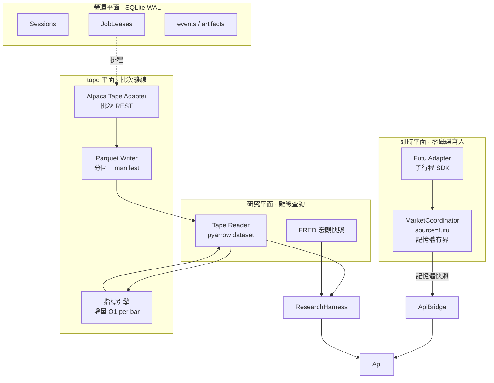
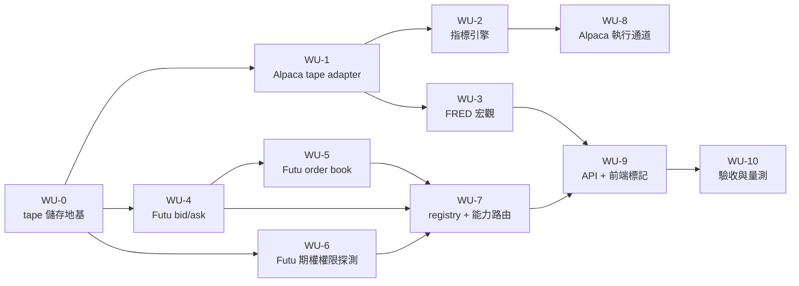

# GabFin 供應商接入執行計劃（Alpaca + Futu OpenD）

> 狀態：計劃，未實作。承接 [provider plan](2026-11-27-gabfin-market-data-provider-plan.md) 的取捨。
> 執行順序：**WU-0 資料地基 → WU-1 → WU-2 → WU-3 → WU-4…**，每個單元測試先行。
> 本文件定義「怎麼存、怎麼跑、效率在哪裡守住」；合約與工作流依 [workflow](../../agents/workflow.md)。

## 0. 使用者已確認的取捨

| 項目 | 決定 | 後果 |
|---|---|---|
| 富途總資產 | 未達 HK$20,000 | 無 OPRA 期權 LV1 權限；**不購買**行情卡 |
| Massive | 不採用（不買 Starter，也不要免費層） | 指標來源 = 本地自算（主）＋ Futu 官方 API（交叉驗證） |
| Alpaca 層級 | 免費 Basic | 月費 HK$0；IEX 即時 + SIP 全市場歷史 |
| 宏觀 | FRED | 免費；Massive Economy 不接入 |

---

## 1. 現有邊界（實測核對，非推測）

工作目錄 `C:/Users/001/Downloads/GabFin-ai-trade`

### 1.1 已存在的部分（可複用，不要重寫）

| 模組 | 現有能力 | 關鍵約束 |
|---|---|---|
| [market/coordinator.py](../services/gabfin/market/coordinator.py) | 有界 quote cache、bar cache、replay、recovery、gap | **`self._source` 單一來源**：`event.source != self._source` 直接 raise |
| [market/stream.py](../services/gabfin/market/stream.py) | 每標的 quote 合併器，latest-only | 已明確「不適合 tick/fill/量能聚合」 |
| [market/bars.py](../services/gabfin/market/bars.py) | event-time bar 聚合，已有 `volume` | 只支援 second/minute 固定週期 |
| [market/subscriptions.py](../services/gabfin/market/subscriptions.py) | 配額預算、優先級排序、advisory plan | **`caps.source != 'futu'` 直接 raise** — 已被寫死成 Futu 專用 |
| [market/supervisor.py](../services/gabfin/market/supervisor.py) | feed 生命週期、cleanup 驗證、gap 恢復 | 單一 feed owner；`ManagedFeedAdapter` 介面已定 |
| [providers/futu/quote_push.py](../services/gabfin/providers/futu/quote_push.py) | quote 正規化、去重、時鐘偏斜拒絕 | **只讀 `last_price`，無 bid/ask** |
| [providers/futu/options.py](../services/gabfin/providers/futu/options.py) | 期權鏈取樣、額度釋放驗證 | 欄位白名單不含擺盤 |
| [storage/database.py](../services/gabfin/storage/database.py) | SQLite WAL、`foreign_keys=ON`、`busy_timeout=5000` | 單機 |
| [storage/migrations.py](../services/gabfin/storage/migrations.py) | 原子 migration，拒絕未知版本 | 現有表：`schema_migrations`／`instruments`／`events`／`job_runs`／`job_leases`／`artifacts` |
| [api/market_gateway.py](../services/gabfin/api/market_gateway.py) | API→行情行程的租約橋接 | 每連線 `ScopedMarketConnection` 綁定單一 source |
| [contracts/market.py](../services/gabfin/contracts/market.py) | `QuoteSnapshot` 已有 `quality`／`entitlements`／`QuotePoint.age_ms` | `QuoteQuality` 已含 `INDICATIVE`／`DELAYED`／`UNAVAILABLE`／`PERMISSION_DENIED` |

### 1.2 缺的部分（本次要建）

- 無 Alpaca provider、無 registry、無指標模組、無宏觀模組、無 tape 儲存。
- [contracts/subscriptions.py](../services/gabfin/contracts/subscriptions.py) 的 `FeedCapabilities` 有 `latency_label`（`unknown|realtime|delayed|indicative`）但**沒有 venue 覆蓋欄位**。
- `MarketRequest.keys` 上限 64；`MarketCoordinator` 標的上限 1000、required_keys 上限 3000。

### 1.3 環境事實（已驗證）

- `.venv` 已有：`pydantic` `fastapi` `uvicorn` `websockets` `pytest` `requests` `alpaca-py` `pandas` `numpy` `pyarrow`。
- **未安裝**：`duckdb`、`httpx`、`polygon`、Futu SDK（僅 owner 機器）。
- `pyarrow` 已在 → Parquet tape **不需要新相依**；DuckDB 是選配，不是必需。

---

## 2. 架構決定（先答「怎麼存、怎麼跑」）

### 2.1 三層資料平面（這是整個計劃的骨架）



### 2.2 關鍵決定 D1：即時平面不做磁碟寫入

**決定**：即時 quote 只進記憶體有界 cache（`MarketCoordinator` 既有 `QuoteStream`），**每個 tick 不寫 SQLite、不寫 Parquet、不寫日誌**。

**理由**：
1. 規格 §2.2 已明定「`events` 存重要領域事件，**不同步落盤所有行情 ticks**」。
2. 效率：單股 1m bar 的 quote 更新約 4 次/秒；若每 tick 一次 SQLite commit，WAL 與 fsync 會成為瓶頸，且 quote 的 value 只有 coalesce 意義 —— 落盤只為「保留每個中間值」，對策略毫無價值。
3. 既有 `QuoteStream` 已是 latest-only 合併器，落盤會與它的語意衝突。

**落盤的是什麼**：finalized/corrected **bar**（含 volume）、週期性 snapshot、交易與決策事件、證據。

### 2.3 關鍵決定 D2：歷史 tape 用 Parquet 分區 + manifest（不用 SQLite 存 bar）

**決定**：Alpaca 歷史 bars 落地為 Parquet 分區檔 + JSON manifest；SQLite 只放 manifest 索引摘要與衍生指標點。

**理由**：
1. 10 年 × 1 檔日線 ≈ 2,500 行；10 年 × 1 檔分線 ≈ 1.5M 行。SQLite 存 bar 會讓「一次全量重算指標」變成全表掃描。
2. Parquet 欄位裁剪 + 壓縮讓「讀 1 檔 10 年日線」只讀該 symbol 分區。
3. `pyarrow` 已安裝 → 零新相依成本。
4. 規格 §6 已指定「Parquet 分區及 manifest；DuckDB 離線查詢候選」。

**分區鍵**：`symbol` 為第一層（避免全 symbol 掃描），`timeframe` 第二層，日期作為檔名的一部分而非 Hive 目錄層（目錄深度在 Windows 上有成本）。

**保留策略（使用者已確認 2026-11-27）**：
- **日線：全歷史 10 年**（2016 年起，Alpaca SIP 可得範圍）永久保留。
- **分線：只保留最近 2 年**；更早的分線不落地。
- 保留窗以 `max_event_at` 為界，寫入時舊於窗界的列直接丟棄（不需二次清理），避免每次寫入都做全檔掃描。
- 2 年分線 ≈ 300K 列/檔 ≈ 10–20MB/檔（zstd 後）；50 檔全市場 ≈ 500MB–1GB，可接受。
- 磁碟估算隨標的數擴大，故 tape 寫入必須**逐標的增量**（append 到當月 partition），不可一次性全量重寫。

```
runtime/tape/
  equity/
    AAPL/
      1day/
        2026-11.parquet        # 單檔單週期單月
      1min/
        2026-11.parquet
  manifest/
    equity/1day/AAPL.json     # 覆蓋區間、列數、checksum、來源、調整政策
```

**manifest 內容**（每 symbol+timeframe 一份）：
```json
{
  "schema_version": "1.0",
  "symbol": "AAPL",
  "timeframe": {"count": 1, "unit": "day"},
  "source": "alpaca:sip",
  "venue_coverage": "sip",
  "adjustment": "all",
  "files": [{"path": "equity/AAPL/1day/2026-11.parquet", "rows": 21,
             "min_event_at": "...", "max_event_at": "...", "sha256": "..."}],
  "coverage": {"start": "2016-01-04T05:00:00Z", "end": "2026-11-26T05:00:00Z"},
  "written_at": "2026-11-27T04:00:00Z",
  "complete": true
}
```

### 2.4 關鍵決定 D3：指標引擎增量、單次寫回 Parquet

**決定**：指標以 **bar 為增量單位**，每根新 final bar 只做 O(1) 更新，並把新指標點 append 進同一分區檔的衍生欄位（或獨立 `indicators/` 分區）。

**理由**：這是本計劃最大的效率陷阱。若前端每次輪詢都對 1.5M 行重算 MACD，p95 會直接爆掉。設計上：

| 指標 | 增量方式 | 每 bar 成本 |
|---|---|---|
| SMA(n) | 滑動視窗 deque 求和 → O(1) | O(1) |
| EMA(n) | `ema' = ema + α(p − ema)` → O(1) | O(1) |
| MACD(12,26,9) | 由兩條 EMA + EMA of DIFF → O(1) | O(1) |
| RSI(n) | Wilder 平滑 → O(1) | O(1) |
| ATR(n) | Wilder 平滑 TR → O(1) | O(1) |
| Stochastic | 滾動 high/low 視窗 → O(1) | O(1) |
| Bollinger(n,k) | 滾動和 + 滾動平方和 → O(1) | O(1) |
| OBV / MFI / Volume SMA | 累加器 + 滾動視窗 → O(1) | O(1) |

**全部 O(1)**，無需重算歷史。啟動時以 manifest 覆蓋區間的末值做種子（seed），避免重算。

### 2.5 關鍵決定 D4：多來源用「每來源一個 coordinator」，不合流

`MarketCoordinator.apply()` 對 `event.source != self._source` 直接 raise；`QuoteMarketEvent` 又要求 `envelope.source == payload.feed`。這是**刻意的正確性設計**（不讓不同來源的事件進入同一去重/序號證據鏈）。

**因此不做 fan-in merge**。改為：

```
providers/registry.py
  capability → (source, adapter_kind) 映射
  equity_quote   → futu      → FutuCoordinator
  order_book     → futu      → FutuCoordinator
  option_quote   → futu      → FutuCoordinator（無權限 → 回報 unavailable）
  bars/history   → alpaca   → tape 平面（非 coordinator）
  indicators     → local     → tape 平面
  macro          → fred      → 宏觀平面
  execution      → alpaca_trading → OMS（尚未存在）
```

`api/market_gateway.py` 依 request 的 capability 路由到對應 coordinator 實例。每個 coordinator 有獨立 event loop、獨立 `_seen`/`_bars`/`_history`，**無跨來源競爭，無合併延遲**。

**代價**：`market/subscriptions.py` 目前寫死 `caps.source != 'futu'` raise，須改為來源無關的分組邏輯（見 WU-7）。

### 2.6 關鍵決定 D5：能力不可用時回報 unavailable，絕不靜默降級

- Futu 無 OPRA 權限 → 期權報價能力回報 `unavailable`，UI 顯示「無即時期權權限」。
- Alpaca indicative → 強制 `QuoteQuality.INDICATIVE` + `tradable_for_entry=False`。
- Alpaca 歷史若 `end` 未滿 15 分鐘 → `feed=sip` 必然 403，adapter 先本地檢查再降級 `feed=iex` 並在能力快照標示「近 15 分鐘為 IEX 口徑」。

---

## 3. 效率預算（提案，需實測確認）

沿用規格 §12 目標，新增本層的量測點。**全部是待量測目標，不是已達標數字。**

| 面向 | 目標 | 量測方式 |
|---|---|---|
| quote 接收 → UI 渲染 | p95 ≤ 1s | 既有 `market-trace.ts` 四層 trace |
| API 快照（熱） | p95 ≤ 300ms | 既有 S04/04e 基線 129.4ms |
| 桌面切頁（熱快取） | p95 ≤ 500ms | 既有 31.3ms |
| 即時平面磁碟寫入 | **0 writes/秒** | SQLite write counter 於 quote 路徑 = 0 |
| 單檔 10 年日線冷讀 | ≤ 500ms | pyarrow dataset filter 計時 |
| 單檔指標全量冷算 | ≤ 2s（增量引擎下 ≤ 200ms） | 種子 vs 全量比對 |
| 新增一根 bar 的指標更新 | p95 ≤ 1ms | 引擎 micro-benchmark |
| Parquet 寫入 | 單檔單月 ≤ 2s | 500 檔日線 ≈ 30s（批量） |
| Alpaca 呼叫節流 | ≤ 200 req/min，且不觸發 429 | token bucket 計數 |
| 行情→UI 端到端 quote 延遲 | 報告 `event_at → received_at` 實測分佈 | 既有 feed-entitlements 未量測項 |

---

## 4. 執行順序與依賴



**先做 WU-0 的理由**：所有 provider 都要寫入或讀取 tape；先定 storage contract 與分區格式，後續 adapter 才有穩定介面，避免各自發明格式再回頭遷移。

---

## 5. 工作單元

### WU-0 — Tape 儲存地基

**新增** `services/gabfin/storage/tape.py`、`services/gabfin/storage/manifest.py`、`services/gabfin/contracts/tape.py`

**介面**（新 contract `contracts/tape.py`）：
- `TapeSeries` — `{symbol, timeframe, source, venue_coverage, adjustment, coverage_start, coverage_end, row_count, complete, retention}`
  - `retention` — `Literal['full_history', 'rolling_2y']`；寫入端依此決定丟棄窗外的列
- `TapePartition` — `{path, rows, min_event_at, max_event_at, sha256}`
- `TapeManifest` — `{schema_version, series: TapeSeries, partitions: tuple[TapePartition, ...], written_at, complete}`

**`storage/tape.py`**：
- `write_partitions(directory, series, frames) -> tuple[TapePartition, ...]`
  - 以 pyarrow 寫 Parquet；壓縮 `zstd`；欄位型別固定：`event_at`(timestamp[us, UTC])、`open/high/low/close/volume`(decimal128 或 float64？→ **用 float64 存 tape，進 contract 時轉 Decimal**，避免 Parquet 撐不住 Decimal 的精度語意) —— 需在 manifest 記錄精度聲明。
  - **保留窗過濾**：寫入前依 `series.retention` 丟棄窗外列 —— `full_history` 不丟棄；`rolling_2y` 丟棄 `event_at < now − 730 天` 的列。過濾在**寫入前**完成（不需事後清理掃描）。
  - **原子寫**：先寫 `.tmp` 再 `os.replace`，避免半檔被讀到。
  - **manifest 先行**：寫完 partition 後才更新 manifest；manifest 的 `complete=false` 表示未完成，讀取端需據此拒絕。
  - **append 而非重寫**：既有 partition 只 append 新列（讀舊檔 + concat + 重寫該檔），不做全量重寫；這是磁碟與 IO 成本的關鍵。
- `read_partitions(directory, series, start=None, end=None)` — 以 pyarrow dataset filter 做時間範圍裁剪。
- `merge_manifest(old, new) -> TapeManifest` — 覆蓋區間合併、重疊以新為準、舊 partition 保留不刪（避免誤刪歷史）。

**`storage/manifest.py`**：manifest 檔案的原子寫（`tmp` + `replace`）與讀取校驗（JSON schema 形狀、checksum 存在）。

**Storage 邊界（必須寫進 docstring）**：
- tape 是**append-only 的衍生資料**，可整個刪除重建；manifest 是 tape 的索引，不是權威來源。
- tape 路徑在 `runtime/`（gitignored），**不進 git**。
- 回測用的 dataset 必須記錄 manifest 的 `sha256`，才能重現。
- **保留窗外的列不是錯誤**：讀到窗外的資料應報「超出保留窗」而非靜默截斷，避免以為有完整歷史。

**測試** `tests/gabfin/storage/test_tape.py`：
- 寫入→讀回 round trip，值相等且型別穩定
- 原子性：寫入中途模擬失敗 → 不留半檔、manifest 仍指向舊狀態
- 分區合併：覆蓋區間正確、舊 partition 未被刪
- 範圍讀取只回傳區間內列
- 缺 manifest 的目錄 → 明確報錯，不猜
- **保留窗**：`rolling_2y` 丟棄窗外的列；`full_history` 不丟棄；讀到窗外資料報「超出保留窗」而非靜默截斷
- **append 正確性**：對既有 partition append 後，舊列仍在、新列加入、無重複

**效率驗收**：寫 500 檔日線單月（≈10,500 列）≤ 30s；單檔讀 10 年 ≤ 500ms；對既有 partition append 單月（≈1,500 列）≤ 2s。

---

### WU-1 — Alpaca tape adapter

**新增** `services/gabfin/providers/alpaca/{__init__,feed_guard,capabilities,history,symbols}.py`

**`feed_guard.py`**：
- `sip_history_window(now) -> datetime` — 回傳「最近可安全查 SIP 的 end 時刻」（now − 15min，向下取整到分）。
- `resolve_feed(requested, now) -> 'sip' | 'iex' | raise` — `feed=sip` 且 end 超界 → 降級 `iex` 並回報降級理由；`feed=opra` → 直接 raise（免費層無 OPRA 權益，回報「需 Algo Trader Plus」）。
- `SIP_FORBIDDEN_CODE = 'subscription does not permit querying recent SIP data'` → 辨識為**權益不足**而非「無資料」。

**`capabilities.py`**：
- 啟動實測：`GET /v2/stocks/trades/latest?symbols=AAPL&feed=iex` 判斷即時可用性；`GET /v2/stocks/AAPL/bars?feed=sip&end=<15min前>` 判斷 SIP 歷史可用；`GET /v1beta1/options/contracts?underlying_symbol=SPY` 判斷期權結構可讀。
- 輸出 `FeedCapabilities`（既有 contract）+ 擴充欄位（見 WU-9）。

**`history.py`**：
- `fetch_bars(symbols, timeframe, start, end) -> Iterator[dict]`：
  - **關鍵**：`GET /v2/stocks/bars?symbols=A,B,C&limit=10000` 的 `limit` 是**跨所有標的總列數**，不是每標的。必須跟 `next_page_token` 翻頁直到為空，否則只會拿到第一個標的。這是本單元最容易出錯的地方，必須有針對性測試。
  - 節流：token bucket，200 req/min（免費層），滿則等待；記錄被限流次數（不靜默截斷）。
  - `feed=sip` + `end` ≥ 15 分鐘前 → 全市場 NBBO 與**真實成交量**。
- `fetch_option_contracts(underlying) -> list[dict]` — 只取結構（到期日、行權價、right、張數），**不取價**。
- `fetch_screener(kind, top) -> list[str]` — `/v1beta1/screener/stocks/most-actives`、`/v1beta1/screener/{market_type}/movers`（top ≤ 50）建立候選池。

**`symbols.py`**：Alpaca 純 ticker ↔ Futu `US.AAPL` 雙向對映（既有 `providers/futu/symbols_wire.py` 已有反向邏輯，此處只補正向與衝突偵測）。

**測試** `tests/providers/alpaca/`：
- `test_feed_guard.py`：SIP 15 分鐘界線、降級理由、indicative 攔截、OPRA 直接報錯、403 權益碼辨識
- `test_history.py`：**跨標的 `limit` 翻頁正確性**（模擬三標的、limit 小於總列數，斷言三標的都有資料）、節流不超 200/min、量能欄位存在
- `test_capabilities.py`：權益探測結果映射

---

### WU-2 — 指標引擎（增量）

**新增** `services/gabfin/indicators/{__init__,engine,contract,sma,ema,macd,rsi,atr,bollinger,stochastic,volume}.py`
**新增** `services/gabfin/contracts/indicator.py`

**`contracts/indicator.py`**：
- `IndicatorPoint` — `{indicator, params, timeframe, value, event_at, computed_at, source_coverage, computed_by, realtime}`
  - `source_coverage`：`'iex' | 'sip' | 'futu_nasdaq_totalview' | 'futu_arca'`
  - `computed_by`：`'local' | 'futu_api'`
  - **強制**：`source_coverage` 必填 —— 否則 IEX 口徑與 SIP 口徑的量能型指標（OBV/MFI）會被誤用。

**`engine.py`**：
- `IndicatorEngine.seed(series, bars) -> EngineState` — 由 tape 尾端重建狀態（不重算全史）
- `IndicatorEngine.update(state, bar) -> tuple[IndicatorPoint, ...]` — 一根新 final bar → O(1) 更新
- 每個指標各自持有增量狀態；`SMA` 用滑動 deque，`EMA/MACD/RSI/ATR` 用 Wilder/遞推式。

**指標清單**：
- 趨勢：SMA、EMA、WMA、MACD(DIFF/DEA/HIST)
- 動能：RSI、Stochastic(%K/%D/%J)、ROC、Momentum
- 波動：ATR、Bollinger(UPPER/MIDDLER/LOWER + %B + bandwidth)、Donchian、Historical Volatility
- 量能：OBV、Volume SMA、MFI、VWAP

**與既有 [market/bars.py](../services/gabfin/market/bars.py) 對接**：bar 已有 `volume` 與 `status`；指標只消費 `status != forming` 的 bar。

**輸出落地**：指標點 append 進 tape 的獨立分區 `runtime/tape/indicators/{symbol}/{indicator}/...`，或直接在 bar partition 加衍生欄位（後者讀取更快但寫入成本更高 → **採用獨立分區**，bar 檔保持不可變）。

**測試** `tests/indicators/`：
- `test_engine.py`：對照已知參考數值（固定 seed bars，斷言具體數字）
- `test_incremental.py`：**增量結果 == 全量重算結果**（關鍵不變式，兩條路徑必須一致）
- `test_atr.py` / `test_bollinger.py` / `test_macd.py`：真值測試 + lookback 不足時 `insufficient_history`

---

### WU-3 — FRED 宏觀

**新增** `services/gabfin/providers/fred/{__init__,client,series,fetch}.py`
**新增** `services/gabfin/contracts/macro.py`

- `MacroPoint` — `{series_id, observation_date, release_date, value, units, frequency, vintage}`
  - **必須保留 `release_date`**（回測不得使用未發布資料）
- `client.py` — FRED REST；API key 只從環境變數 `FRED_API_KEY` 讀取（新增到 `.env.example`）。**key 只出現在 URL query（供應商強制），必須確保不進日誌、不進錯誤訊息、不進前端 bundle**。
- `series.py` — 內建序列定義：
  - 利率：`DGS2` `DGS10` `T10Y2Y` `DFEDTARU` `DFEDTARL` `SOFR` `RRPONTSYD`
  - 通膨：`CPIAUCSL` `PCEPILFE` `CPIREL`
  - 就業：`UNRATE` `PAYEMS` `JTSJOL` `CIVPART`
  - 風險：`NFCI` `BAMLH0A0HYM2` `STLFSI4`
- `fetch.py` — 批次抓取 + 落地（SQLite `macro_observations` 表或 tape 分區）；限流 v1 120 req/min。
- **宏觀不進 quote 通道**，另開 macro 平面（見 §2.1）。

**測試** `tests/providers/fred/`：金鑰不外洩至日誌／錯誤訊息／例外、`release_date` 保留、限流。

---

### WU-4 — Futu quote 補齊 bid/ask

**修改** `services/gabfin/providers/futu/{quote_push,quote_worker,adapter}.py`

- `quote_push.py`：`QuoteMailbox.offer` 欄位白名單由 `{code, last_price, data_date, data_time}` → `{code, last_price, bid_price, ask_price, bid_size, ask_size, data_date, data_time}`；缺失時保留 `None`，**不製造假值**。保留 `source_clock_ahead` / `late_or_duplicate` 去重語意。
- `quote_worker.py`：訂閱加 `SubType.ORDER_BOOK`；`is_detailed_orderbook=False`。
- `adapter.py`：`_apply_quote` 產出 `QuoteSnapshot` 時填 `bid`/`ask`/`last` 三個 `QuotePoint`。
  - **關鍵**：`QuoteSnapshot._honest_observations` 已有嚴格驗證 —— `event_at` 為 `None` 必須標 `QuoteQuality.INCOMPLETE`；bid > ask 必須標 `CROSSED`；`entitlements.status == DENIED` 必須標 `PERMISSION_DENIED`。擴充時**不得放寬這些檢查**。
- 額度注意：美股正股 100 個（總資產 <1 萬 HKD）。

**測試** `tests/providers/futu/test_quote_bidask.py`：bid/ask 缺失時的降級行為、crossed 標記、重複丟棄。

---

### WU-5 — Futu order book 通道

**新增** `services/gabfin/providers/futu/order_book_push.py`、`services/gabfin/contracts/orderbook.py`

- 仿 `quote_push.py` 的 mailbox / 子行程隔離模式（**不得阻塞事件迴圈**）。
- 輸出 `{code, side, price, size, level}`；美股 LV1 只有 1 檔 → `level` 恆為 1，深度不足要如實標記（不可假裝多檔）。
- `FeedCapabilities` 需新增 depth 描述（見 WU-9）。

**測試** `tests/providers/futu/test_order_book.py`。

---

### WU-6 — Futu 期權權限探測（無 OPRA 權限情境）

**修改** `services/gabfin/providers/futu/{preflight,options}.py`

- `preflight.py`：把 `option_chain` / `option_quote` 從 `unverified` 改為**實測**，輸出 `entitlement: granted | denied | unavailable` 與原因（`total_assets_below_threshold`、`opra_card_required`、`lv1_only`）。
- `options.py`：`errors` 白名單加入 `entitlement_denied`、`depth_unavailable`。
- **重要待驗證事實**：期權鏈的**結構**（到期日、行權價清單）在無 OPRA 報價權限時是否仍可取得。若不可得 → 期權功能在系統內整體停用而非半殘。此點需在 WU-10 實測確認。

**測試** `tests/providers/futu/test_entitlement.py`。

---

### WU-7 — Registry 與能力路由（多來源）

**新增** `services/gabfin/providers/registry.py`
**修改** `services/gabfin/market/subscriptions.py`、`services/gabfin/api/market_gateway.py`、`services/gabfin/contracts/subscriptions.py`

- `registry.py`：版本化的能力→供應商映射（從環境變數解析，**無預設供應商**），每個能力獨立綁定：
  `equity_quote`→futu、`order_book`→futu、`option_chain`→futu、`option_quote`→futu、`bars`/`volume`→alpaca、`indicator`→local、`macro`→fred、`execution`→alpaca_trading。
- `subscriptions.py`：移除 `caps.source != 'futu'` 的寫死，改為**來源無關**的配額分組（equity pool / option pool），並讓配額容量由 registry 提供的 capability 決定。
- `market_gateway.py`：依 request 能力路由到對應 coordinator 實例（每來源一個 coordinator，見 D4）。
- 不可用時**明確報錯**（`unavailable` + 原因），禁止靜默降級。

**測試** `tests/providers/test_registry.py`、`tests/gabfin/test_subscription_planner.py`（來源無關化後需重跑既有測試）。

---

### WU-8 — Alpaca 執行通道（paper 期權）

**新增** `services/gabfin/providers/alpaca/{execution,orders}.py`、`services/gabfin/execution/`（最小骨架）

- paper 帳戶預設已開通 Level 3 期權（calls/puts/spreads/straddles/strangles/iron butterfly/iron condor）。
- 下單前以 **Futu 即時 bid/ask** 做 price protection；**不得以 indicative 價格做保護**。
- `client_order_id` 冪等鍵、outbox、重啟對帳屬規格 Task 12/13，本單元只做「送出→查詢→取消」的最小区間，不做完整 OMS。

**測試** `tests/providers/alpaca/test_execution.py`（用 fake client，不打真實網路）。

---

### WU-9 — 合約擴充、API 與前端標記

**修改** `services/gabfin/contracts/{subscriptions,market,feed}.py`
**新增** `services/gabfin/contracts/indicator.py`（若 WU-2 未建）、`services/gabfin/api/{indicators,macro}.py`
**修改** `apps/desk-web/src/features/{market,chart}/`

- `FeedCapabilities` 新增：`venue_coverage`、`realtime`、`delay_minutes`、`tradable_for_entry`、`depth_levels`、`fee_class`
- `QuoteSnapshot` 已有 `quality`/`entitlements`，需補 `venue_coverage` 與 `source_provider`
- 新增 `indicative` 強制語意：`tradable_for_entry=False`；`FeedCapabilities` 需支援 `unavailable` 狀態
- 新增 `/v1/indicators`、`/v1/macro` 端點，走既有 [api/market.py](../services/gabfin/api/market.py) 的認證與訂閱模式
- 前端：quote 面板顯示來源與覆蓋（「Futu / Nasdaq TotalView 60檔」對比「Alpaca / IEX 2.5%」）；期權頁對 indicative 醒目標示「測試數據，不可作為進場依據」，對無權限顯示「無即時期權權限」；指標 badge 顯示 `computed_by` 與口徑；指標疊圖於既有 Lightweight Charts 之上

**測試**：`tests/gabfin/test_indicator_contracts.py`、既有 925 core + 31 Playwright 需全綠。

---

### WU-10 — 驗收、量測與煙霧

**真實帳號煙霧**（腳本化，記錄到 `docs/audit/`）：
1. Alpaca paper 期權多腿單：送出 → 確認 → 平倉
2. Alpaca SIP 歷史：多標的翻頁正確性 + 量能欄位 + manifest checksum
3. Futu 正股 quote 與 order book（60 檔）
4. Futu 期權：**在無 OPRA 權限下的實際回應**（記錄可用/不可用邊界）
5. Futu 指標 API 對照本地自算 MACD/RSI（記錄數值差異與口徑）
6. FRED 宏觀抓取 + `release_date` 檢查
7. 延遲量測：`event_at → received_at → UI` 全鏈路分佈

**量測輸出**：`docs/audit/artifacts/` 存 JSON 證據；更新 [feed-entitlements](../audit/feed-entitlements.md) 的 G2 票證據。

**既有迴歸**：925 core / 31 Playwright 需維持全綠；`npm.cmd run build` 必須在 Playwright 之前（04e 教訓，見 [issues](memory/issues.md)）。

---

## 6. 主要風險與對策

| 風險 | 影響 | 對策 |
|---|---|---|
| Alpaca 多標的 `limit` 是**總列數** | 只取到第一個標的，靜默資料缺口 | 強制翻頁至 `next_page_token` 為空，並有針對性測試 |
| `feed=sip` 近期查詢 403 | 研究資料被誤判為「無資料」 | `feed_guard` 本地預檢 + 權益碼辨識，錯誤訊息區分兩者 |
| indicative 報價流入決策路徑 | 實盤幻覺 | `tradable_for_entry=False` 強制 + UI 標記 + 交易意圖校驗拒絕 |
| 期權 OPRA 缺權限 | 期權即時功能不可用 | 回報 `unavailable`（非假價），結構資料可否取得待實測 |
| tape 檔案膨脹 | 磁碟與掃描成本 | symbol 分區 + zstd + 不刪舊 partition + manifest 覆蓋區間 |
| 指標全量重算 | p95 爆掉 | 增量 O(1) 引擎 + seed 種子 + 「增量 == 全量」不變式測試 |
| 多來源誤入同一 coordinator | 去重/序號證據失效 | 每來源一個 coordinator（單來源不變），不合流 |
| 磁碟寫入拖慢即時路徑 | quote 延遲 | 即時平面零磁碟寫入（可量測） |
| 秘密外洩 | 安全事故 | 秘密只在環境變數；FRED key 雖須入 query，禁止入日誌/錯誤/bundle |

## 7. 尚未解決、需實測或使用者決定的問題

1. **期權鏈結構在無 OPRA 權限下是否可讀** → WU-10 實測。
2. **Futu 免費 LV3 是推廣期免費**，平台保留調整權利 → 需要一個「權限降級」的明確回報路徑（WU-7 registry 的 `unavailable` 語意已涵蓋）。
3. **Futu 免費 LV3 的 NYSE ArcaBook 深度需先完成「非專業投資者評估問卷」** → 屬使用者端一次性動作，需在 WU-5 實測前完成。
4. **10 年分線 tape 的磁碟量估算** → 約 1.5M 列/檔 ≈ 40–80MB/檔（zstd 後）。若要 50 檔全市場分線，磁碟需數 GB。是否只保留分線於最近 2 年、日線全歷史？→ **使用者已確認（2026-11-27）：日線全歷史 + 分線只留最近 2 年。**
5. **指標的語意基準**：本地自算 vs Futu 官方 API 參數預設可能不同（如 RSI 預設 window 12 vs 常見 14）→ 需固定一組 canonical 參數並記錄。
