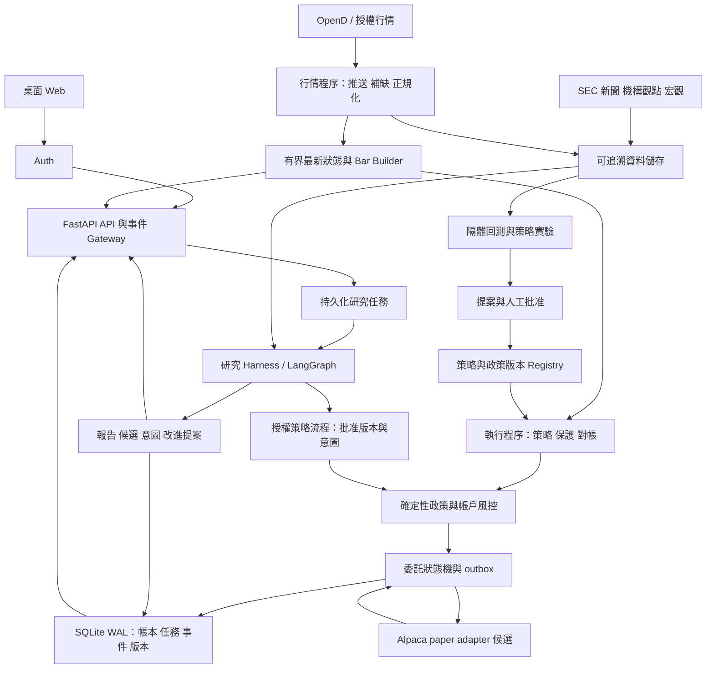

# GabFin 系統需求與架構設計

日期：2026-11-25，Asia/Hong_Kong。狀態：需求訪談已結束；本文件的技術選型為工程提案，尚未實作或通過 runtime 驗收。

配套：[詳細升級計劃](../plans/2026-11-25-gabfin-upgrade-plan.md)。需求以本文件為唯一來源；任務、驗收及遷移順序以配套計劃為準。

## 1. 目標及決策標籤

建立個人交易工作台（桌面網頁）：可即時查看股票／期權、研究、策略與 paper 帳戶；股票策略可自動做多及做空；研究可持續提出有證據的改進。

- **U：使用者確認**。不可由工程師靜默更改。
- **P：工程提案**。可以經證據修訂，必須同步文件與測試。
- **G：啟用前關卡**。未達成時相應功能不可標示可用，不妨礙其他獨立工作。
- **E：已有證據**。只代表指定檔案／文件被讀取，不等於實測通過。

## 2. 使用者確認需求 U

| ID | 需求 |
|---|---|
| U01 | 第一版先供個人使用，可遠端存取；預留未來多人能力，不優先做收費系統。 |
| U02 | 前端全面重寫，僅桌面網頁（不含 iPhone App、PWA 及手機版面）；初期私人連線。 |
| U03 | 美股股票與期權；股票包含自動 paper 做多／做空，期權第一版只做行情、期權鏈與研究。 |
| U04 | 第一版同時具備日內及可持有數週的波段策略；已取消最多兩天與日內必須當天清倉的限制。 |
| U05 | 股票 paper 支援盤前、正常時段、盤後；整夜 20:00–04:00 ET 不自動納入本次範圍。 |
| U06 | Paper 初始本金 US$100,000；當前階段不啟用真實資金交易。 |
| U07 | 股票池動態更新：機構觀點、事件、市場掃描及使用者清單；任意美股清單可獨立分析。 |
| U08 | 機構／金融公司來源由工程研究選擇；使用者沒有指定清單。 |
| U09 | Agent 可自主更新候選、分析、意圖，並在已批准策略及參數範圍內 paper 交易。 |
| U10 | 新策略版本、超出批准範圍的參數、風險上限及真倉啟用，需要使用者批准。研究可持續進行。 |
| U11 | 動態止損、動態倉位、可配置單筆計劃風險；不固定 1%；開始 paper 前批准具體設定。 |
| U12 | 帳戶最大回撤驗收上限 40%；不是單筆止損幅度、盈利目標或損失保證。 |
| U13 | App 聊天只可查帳戶、分析股票清單、啟動研究、產生交易方案；不得下單、取消、啟停交易或改風控。 |
| U14 | 桌面控制台可提供既定 paper 啟停、停止新增交易、取消委託；不提供提高風險上限。 |
| U15 | 行情過期停止相關新增入場；既有保護及對帳繼續。LLM 失效不停止不依賴該次 AI 的已批准規則策略。 |
| U16 | 本機開發；所需運行時段保持主機開機、不睡眠。 |
| U17 | 預算 HK$400／月；必要的即時期權資料可考慮再增加約 HK$100，具體方案與費用需核對。 |
| U18 | 架構不以舊 repo、ADR、框架為既定約束；保留或替換由新需求、測試與整合成本決定。 |
| U19 | 保留 REA=morluto/rea、ECC=affaan-m/ECC、ORCA=stablyai/orca 作評估；不採用 Claude-Mem。 |
| U20 | 成功評估以樣本外、成本後收益及基準比較為主，同時顯示穩定性與風險，由使用者決定部署版本。 |
| U21 | 中文彙報，產品以桌面繁體中文為主；技術識別字保留原文。 |
| U22 | 研究首頁以主動發現機會為主；任意股票分析隨時可用；有持倉時重要風險及變化置頂。 |
| U23 | 重點候選呈現 why-now、時間尺度、支持證據、反證、觀察／入場及失效條件、缺資料；允許沒有足夠優勢及不完整報告。 |
| U24 | 在既有預算內廣泛初篩、集中深研；使用者點選股票及持倉重大變化優先，清楚區分初篩與已深入研究。 |
| U25 | 已批准規則策略作基線；規劃 AI 參與交易判斷的受控試驗，在相同資料／成本／評估條件下證明增值，再依既有治理提升責任。 |

U14 的交易控制僅限明確 UI 操作，不能由聊天呼叫。U04 的日內／波段標籤代表策略特徵，不可為隱藏虧損而重新歸類持倉。

## 3. 已有程式及證據邊界 E

GitHub：`cgabrielck/cgabrielck-stock-analyzer`，已能讀取私人 repo。
分析基準：`42f96b3b8a39e40f2e4e579aa9e619814dc80e7b`；2026-11-25 再次確認 main tree 相同且未截斷。
本機規劃目錄下已有隔離應用 checkout；S01 基線及 S02/02a、02b 已完成。實際版本、驗證與限制以 [execution checkpoint](../../memory/execution.md) 及其 audit links 為準。

| 領域 | 已讀取的證據 | 對計劃的影響 |
|---|---|---|
| 行情 | `backend/api/desk_observe.py` 15 秒輪詢，前端 bars 20 秒更新 | 重建真正推送鏈路。 |
| 首屏 | `web/static/index.html` 先等待 meta、account、worker | 首屏與外部帳戶回應解耦。 |
| 掃描 | `recommender.py` 分階段串行；`data_fetcher.py` 基本面預設 3 workers，多項網絡讀取 | 分離快慢資料，局部結果串流、去重與 deadline。 |
| Worker | `worker.py` 批次 OHLCV 取得後才檢查策略出場 | 將保護／對帳與研究排程隔離。 |
| 委託 | `order_manager.py`、sticky idempotency、fill honesty | 優先移植行為測試；實作仍需競態及恢復驗證。 |
| 儲存 | SQLite 委託帳本與多種 JSON 狀態並存 | 統一重要狀態、版本與交易式邊界。 |
| 身份 | loopback 直接 operator；經代理的實際身份未測 | 取消以來源 IP 自動賦權的設計。 |
| 回測 | `strategy_backtest.py` 開盤 sizing 用當日 close；成本及最終平倉口徑不一致 | 先建立可信裁判，再選策略。 |
| 歷史結果 | fair report 舊版本 aggressive +22.39%，同期 SPY +86.65%，約三年 | 只是舊報告；不可冒充最新重跑結果。 |

尚未完成：完整程式審計、新架構整合測試、瀏覽器驗收、效能量測、依賴漏洞掃描、秘密／Git 歷史掃描、OpenD 擁有者機器權限測試。已執行的基線與契約測試不代表這些關卡通過。

## 4. 路線比較及工程選擇 P

| 路線 | 取捨 | 選擇 |
|---|---|---|
| 原地疊功能 | 短期快，但保留互相阻塞及雙 UI 負擔 | 不作主方案。 |
| 整庫從零重寫 | 可清理結構，但需重新發現交易邊界錯誤 | 不預設採用。 |
| 選擇性重建 | 新前端、新行情與排程，測試驅動移植有效資產 | **主方案**。 |

採本機 modular monolith 加少量隔離程序，不先建 Kubernetes、Kafka、十多個微服務或向量資料庫。
FastAPI 保留為 API 技術；領域契約與現有 route 解耦。初期 Alpaca paper adapter 作執行候選。
LEAN 作可信事件回測的首個比較候選；NautilusTrader 作備選，不同時部署兩套正式 OMS。
最終引擎依 spike 的正確性、券商相容、策略共用能力、Windows／WSL 負擔決定，不能只看宣傳 benchmark。

## 5. 目標系統圖



初期 API、行情、execution、research 為分開程序；SQLite 每程序獨立連線。Research CPU 重任務另開受限子程序。
執行端唯一持有 paper 下單憑證。圖表、聊天及研究 Agent 均不取得 broker submit capability。

## 6. 技術栈、目錄及儲存

| 領域 | P 選擇 | 理由／退出條件 |
|---|---|---|
| 前端 | React、TypeScript、Vite、TanStack Query、Lightweight Charts | 私人工作台不先加 SSR；pin 版本、lockfile、typecheck。 |
| API／領域 | Python 3.12 相容性先驗證、FastAPI、Pydantic | OpenD／券商／引擎若不相容，將 adapter 隔離，不強制整庫升級。 |
| 運行狀態 | SQLite WAL、schema migrations、busy timeout、短交易 | 單主機；證實需多機寫入時才遷移 PostgreSQL。 |
| 歷史資料 | Parquet 分區及 manifest；DuckDB 離線查詢候選 | 不以每筆 JSON 整檔覆寫承擔 tick 歷史。 |
| 任務 | SQLite job lease + heartbeat + retry budget | 不依賴 API daemon thread；重啟可恢復。 |
| 即時狀態 | 行情程序有界 cache；API 按訂閱分發 | 不把 Redis 當初期必要依賴；跨機或量測需要才加入。 |
| 研究編排 | LangGraph，包在自有 ResearchRunner 介面後 | 持久化、並行、取消；若成本大於簡單 workflow，保留替換路線。 |
| 私人連線 | Tailscale Serve + HTTPS + 應用 session | 不需要先買域名；代理來源 IP 不等於應用身份。 |

建議新命名空間與舊實作並存，避免無法區分新版／舊版：

```text
apps/desk-web/src/
  app/                 routes、layout、session、繁中文案
  features/            market、chart、research、options、portfolio、orders、controls、journal
  shared/              transport、contracts、components
services/gabfin/
  contracts/           event、market、research、intent、order、policy
  market/              feed coordinator、bars、freshness、subscriptions、replay
  providers/           futu、alpaca、sec、news、macro
  universe/            discovery、observations、membership history、screening
  research/            harness、agents、tools、evidence、budget、jobs
  strategies/          protocol、registry、signal allocation
  execution/           OMS、outbox、broker adapter、reconciliation、protection
  risk/                sizing、limits、exposure、short availability、session policy
  storage/             repositories、migrations、backup
  api/                 routers、auth、websocket、chat capabilities
  experiments/         datasets、runners、metrics、promotion
  ops/                 health、metrics、supervisor、notifications
tests/gabfin/          domain、integration、replay、fault、security
tests/e2e/             desktop、chat、controls、chart
config/                policy templates、feed capabilities，無秘密
runtime/               本機資料，gitignored，不儲存憑證明文快照
docs/superpowers/      設計與任務
```

這是新建路徑提案，尚未建立應用目錄。避免把第三方整庫複製到 `services/`。

## 7. 行情與其他輸入

| 輸入 | 第一選擇及降級 | 更新／品質政策 |
|---|---|---|
| 股票 quote／trade／bar | 先驗證 OpenD API 權益；必要時正式行情 API | 真推送，訂閱按需；無權限明確回報。 |
| 期權 chain／quote | OpenD 或其他已授權源；未確認即時前標示延遲／indicative | 只訂閱當前 underlying、指定到期／履約價窗口；不訂全市場全鏈。 |
| 歷史日線／分鐘線 | 記錄源、調整方式、時段的可版本化快照 | 一次補齊後增量更新，回測不呼叫即時 API。 |
| 申報／財報 | SEC submissions／companyfacts、公司 IR | 保存原文件及 filed/available_at；重述財報不能洩漏到過去。 |
| 機構觀點 | 可授權的 analyst ratings／研究清單；來源研究後登錄 | 分清原機構與聚合商；記錄原始 rating horizon。 |
| 新聞／事件 | 公司公告及合法新聞來源；付費 feed 需預算批准 | 去重、正文來源、published/first_seen；免費路線不承諾專業低延遲新聞。 |
| 宏觀 | FRED／Fed／BLS 官方資料 | 歷史驗證需 vintage／首次公布值；不能回填最新修訂值。 |
| 社群 | 可選公開線索、Agent-Reach 補缺 | 不作硬事實；不可回測假裝當時已取得。 |
| 帳戶／委託／成交 | 券商事件及 reconciliation，SQLite 保存證據 | 本地估值與券商帳本分開標示，不以 limit 冒充 fill。 |

資料源的實際授權、配額、即時性是 G，不因既有報價來源而推定 OpenAPI 同權。
Futu paper 不支援美股延長時段，故不作完整執行後端。Alpaca paper 可作另一帳戶，與行情來源分離；不同 feed 的價格差要可觀測，不能假裝同一本市場。

### 7.1 動態候選池

Discovery 先記 `CandidateObservation`，再做 symbol resolution、來源核對及品質篩選。
候選集合 = 有效機構觀點 + 市場事件 + 可用 scanner + 使用者清單，不以固定股票表充當全市場。
每日／盤前刷新機構與基本面線索，盤中按事件增量更新；過期退出需記錄原因。每次會員變更建立 as-of snapshot。
全部候選可存檔；同時訂閱數受能力 manifest 控制，優先持倉 > 當前圖表 > 活躍策略 > 自選 > 其他候選。
任意美股輸入可分析；非美股、退市、無資料、代碼歧義需逐項回報，不影響同批其他股票。
機構推薦是候選及研究證據，不是自動下單命令；重複轉載不算多份獨立共識。

### 7.2 時間與價格語意

- 儲存 UTC，交易日與 session 使用 `America/New_York` 及交易所日曆；UI 可顯示香港時間。
- 每筆資料區分 `event_at`、`received_at`、`available_at`；指標只消費可得時點資料。
- Bar 有 forming/final/corrected；晚到成交可修正 bar，策略是否重算由版本政策決定，不能重複下單。
- quote、last trade、bar close、券商成交價格各自標示。無事件不等於斷線；heartbeat 與最後市場事件分開量測。
- 初始非生產 freshness 提案：活躍入場 quote 超過 5 秒停新入場；需在實際 feed 測試後批准，而非套用日線資料。
- 確定性計時用 monotonic clock；來源事件時間偏移、亂序、重複及序號缺口都可重播測試。

## 8. 研究 Harness 與多 Agent

Harness 為自有應用控制層；LangGraph 管理研究節點，不負責 OMS、broker retry 或即時止損循環。

| 角色 | 輸入／輸出 | 可用能力 |
|---|---|---|
| Discovery | 來源 observations → 候選及納入理由 | 授權來源搜尋、symbol 查核；不讀交易憑證。 |
| Technical | finalized bars／量化特徵 → setup、失效條件、時間尺度 | 指標與數據工具；能用程式算的數字不讓 LLM 猜。 |
| Fundamentals & Events | 申報、公告、新聞 → thesis／事件／矛盾 | 有日期的證據讀取與引用。 |
| Options Research | chain、underlying、利率／IV 資料 → Greeks／情境分析 | 定價及 payoff 計算；無期權下單工具。 |
| Portfolio Analyst | 只讀帳戶快照＋候選 → 曝險／集中／機會成本建議 | 只讀帳戶與風險工具；不調高政策上限。 |
| Experiment Researcher | 封存資料、失敗交易 → 可重現實驗及提案 | 隔離 workspace、受限運算；無券商、無主程序寫入權。 |

證據驗證先用確定性引用／數值檢查，再按需要使用一次 critic。不是每份報告都啟用六個角色。

```text
ResearchRequest
 -> capability/data-quality check
 -> fetch once + immutable snapshot
 -> technical / fundamentals / options（按任務啟用，最多 3 個外部請求並行起步）
 -> evidence validation
 -> portfolio-aware synthesis
 -> structured report + provenance
 -> optional StrategyIntent（僅自動研究流程，聊天啟動流程無權產生可執行意圖）
```

### 8.1 執行與成本控制

- 每 job 有 UUID、版本、deadline、狀態、lease、取消及 idempotency key；重啟恢復不靠長聊天。
- 預設每 node 最多 2 次嘗試，只重試暫時錯誤；job 總 deadline 優先，禁止疊加無限 fallback。
- 初始報告預算 P：輸入最多 20,000 tokens／job、輸出最多 4,000、最多一次 critic；供應商不相容時顯式調整。
- 大表／原文在儲存層，Agent state 只保留摘要、數值、引用及 artifact ID。
- cache key 含 input snapshot、prompt version、model、schema、lang、工具版本；不能只用 ticker。
- 每次模型／工具記 usage、耗時、價格版本及錯誤；本月已支出＋預留任務費不能超過批准 cap。
- 無定價資訊時只允許有明確批准的試驗額度，不能宣稱費用已受控。
- 新聞／網頁／社群文字一律不可信；不得把其中指令變成 shell、政策或交易操作。
- 模型 API 和授權 CLI runtime 可作比較候選；不把 ChatGPT 訂閱當成免費 API 或保證無限運算。

### 8.2 記憶與治理

使用資料庫及 Markdown 專案記憶，不採用 Claude-Mem。聊天記憶、研究證據與交易狀態分開。
學習內容包含成功／失敗、來源、時間與適用範圍；不能把舊反思永久當市場事實。
提案包含 artifact hash、base strategy/policy version、diff、理由、實驗 ID、成本後指標及回退版本。
批准綁定內容 hash；內容改動、政策基線改變或批准過期後必須重新批准。
Agent 不可寫入已部署程式；研究產生檔案必須在隔離目錄，經測試、審查及批准才部署。

## 9. 策略、風控與委託

策略以可重播純函式產生意圖：`evaluate(context: StrategyContext) -> list[StrategyIntent]`。
日內／波段分開策略版本、特徵及績效歸因；帳戶共用 buying power、曝險、回撤與做空約束。
不再設全球兩天或日內收市強制清倉。每個策略可提議持有期及出場規則，部署時作為批准版本一部分。
同 symbol 相反方向意圖由 deterministic allocator 仲裁，初期衝突則不新增，保護既有持倉並記原因；不假裝同一淨額帳戶能獨立持有兩邊。

### 9.1 倉位計算

價格止損距離與帳戶風險是不同量：初步股數 = 計劃風險金額 / 每股入場至止損距離，再受 buying power、總／單股曝險、spread、流動性、借券及 session 限制。
做空使用相反價差方向，價格／數量採 Decimal 與 broker precision；拒絕零距離、NaN、無限值、負數及超出方向的止損。
計劃風險不保證成交損失；跳空、無流動性、停牌與短倉跳漲需壓力測試。
**G：單筆／日虧／總曝險／槓桿／缺資料政策尚無批准數值，配置必須保持不可啟用，不能偷偷以 1%／3% 上線。**
40% 是 U12 驗收上限；runtime halt 的具體門檻及動作仍須批准。畫面須分開展示兩種語意。

### 9.2 Session 與做空

分別建 PRE、REGULAR、POST；按交易日、夏令時間及休市表處理。OVERNIGHT 初期不發新單。
盤前盤後使用 broker 當時允許的訂單型別／TIF，明確開啟 session eligibility；不以市價單假設必然成交。
做空每次入場核對 shortable／borrow availability／margin；第一階段先驗證可借股票。HTB／locate 如無可信支援則拒絕並解釋，不取消做空整體需求。
Paper 模擬可能不包含借券費、召回及真實排隊；報告增加成本情境與能力標籤。

### 9.3 委託與恢復

狀態：PROPOSED → APPROVED → SEND_PENDING → ACKNOWLEDGED → PARTIAL／FILLED／CANCELED／REJECTED；UNKNOWN 為獨立可恢復狀態。
DB transaction 同時保留 intent 消費與 outbox；網絡送單在 transaction 外。依穩定 client_order_id 對帳，不承諾分散式 exactly-once。
timeout／502 不等於拒單；禁止新 key 盲重試。部分成交後取消只取消餘量；filled quantity 單調，狀態根據證據更新。
啟動先 reconciliation，證明只有一個有效 executor，再允許新入場。API 多 worker 不可各自啟動交易循環。
kill／pause 語意分開：pause entries、cancel open、reduce exposure 是不同操作；停止新單不能關掉對帳及可用保護。
延長時段不能假設 broker stop order 仍生效；逐 session 核對支援型別，server-side 條件保護受行情及主機可用性限制。介面必須分開標示券商已接受的保護單與本機監測條件。

## 10. UI、聊天與身份

導航：工作台、行情／圖表、機會池、研究、期權、帳戶／委託、策略實驗、日誌、系統狀態。
桌面首屏：paper／連線／資料時間、曝險與損益、需處理事件、研究入口及明確控制區；圖表／期權鏈獨立頁。
所有金額／百分比有固定單位契約，不用數值大小猜百分比是否乘 100。
資料先顯示有效快取並標 age，背景更新；meta/account/research 不阻塞整頁。大列表虛擬化，圖表增量 update，離頁取消訂閱。
不做 PWA、離線快取或手機版面；瀏覽器重新回到前景時，先重新驗證帳戶／委託與事件序號。

### 10.1 聊天 capability

允許：`read_account`、`resolve_symbols`、`start_research`、`read_report`、`draft_trade_plan`。
禁止：`submit_order`、`cancel_order`、`start_worker`、`pause_worker`、`resume_worker`、`write_policy`、`approve_proposal`。
限制由 server tool registry、service principal、API authorization 共同實施，不只靠提示詞或 regex。
聊天研究輸出的 TradePlan 為 advisory，不可被 executor 當可執行 intent；即使使用者說「批准」也不能經聊天繞過權限。

### 10.2 身份及遠端控制

初期單 owner，明確登入 session；Tailscale 是連線層，不取代應用身份。禁止 localhost 自動 operator。
cookie HttpOnly、Secure、SameSite，寫入有 CSRF／Origin 驗證；WebSocket 驗證 origin 與 session，過期即斷線。
broker／模型 key 只在後端；不放 URL query、前端 bundle、聊天、log、Markdown。
舊 UI token query 捕捉流程不移植。配對登入用短效單次 code，失敗率限制，控制操作有 audit。

## 11. 研究驗證與策略績效

先修／重現舊回測缺陷，再以封存合成資料及同一策略比較候選引擎。
避免把「換引擎後盈利」當工程通過條件；驗收優先查訊號時間、成交先後、成本及帳本一致性。
歷史 universe 包含當時成員、退出／退市及可用推薦資訊；缺少歷史機構推薦時不得宣稱已回測該訊號。
時間切分 train/validation/final holdout，rolling walk-forward；重疊持有期設 purge／embargo，按策略最大 label horizon 計算。
記錄所有參數嘗試；final holdout 不重複用作調參。LLM 歷史研究須限制可讀資料，並承認模型訓練記憶的時間污染風險。
成本包含 commission、spread、滑價、融資／借券估計，不能重複扣減；回報、trade P&L、equity curve 同一口徑。
比較 SPY、適合的多空／曝險匹配基準及簡單策略；報告總回報、CAGR、DD、Sharpe/Sortino、曝險、周轉、勝率、profit factor、R 分布及分期結果。
樣本量、成本敏感度、參數鄰域及市場階段一起報告；不以單一 +25% 或勝率判定好壞。

## 12. 預算及效能目標 P

基礎 HK$400／月；接近期權加額後 HK$500 只是規劃 envelope，未批准任何購買。
初期本機運行：不新增 VPS 或域名固定費；電費、網絡和既有 ChatGPT 訂閱另列，不假裝是零成本。
建議預留：行情最多 HK$150、研究模型 HK$200、備援 HK$50；加額約 HK$100 只在合適期權方案經確認後重新分配。
這是分配提案，不是供應商報價，也不保證資料 entitlement 可在此金額內取得。
Alpaca 官方完整行情 US$99／月超出目標；IBKR 須另有合資格帳戶／權益，單項 OPRA 不保證整體 API 可用。優先驗證現有 OpenD。
機構資料、歷史分鐘線、新聞與 options real-time 分開估價；無適合來源時記為 G，不能以免費 indicative 冒充。

| 指標 | 初始目標／量測條件 |
|---|---|
| 本機快取讀 API | p95 ≤300ms；排除外部 provider，新舊都量測。 |
| 桌面快取後切頁 | 可用內容 p95 ≤500ms。 |
| quote 接收至 UI | p95 ≤1s；另外報 event→receive 延遲。 |
| 下單前本地風控 | p95 ≤100ms，外部借券查詢獨立標示。 |
| 保護循環 | 日內活躍時 scheduler lag p95 ≤1s；不含 broker 回應。 |
| 研究提交 | job ID p95 ≤500ms；快取報告 ≤1s；冷研究依 deadline／階段呈現。 |
| 容量 | 先驗證 50 equities＋單一 underlying 的最多 100 options quotes，實際配額較小就調低並揭露。 |

上述都是尚待量測的目標，不能當已達標數字。無資料訂閱不應造成 UI 假連線成功。

## 13. 開發工具的角色

- REA：按指定研究任務啟用；現成原始碼優先直接讀取，不為展示工具而做 native reverse engineering。
- ECC：評估 review、eval、context 管理能力；不覆寫既有 AGENTS／config，不同時啟用互相衝突 hooks。
- stablyai/orca：開發工作區及隔離 agent 任務管理候選；不作交易 UI 的替代品。Windows、權限模式與資源成本先測。
- 開發中的 Codex 子 Agent 與產品研究 Agent 是兩套生命週期、權限及預算，不共用券商秘密或聊天記憶。
- Claude-Mem 已被使用者取消；先前可能留下 runtime／待完成安裝，未驗證清除，不能宣稱已卸載。後續清理應保留其他工具設定。

## 14. 啟用關卡及可接受的未決項

G1：取得完整 source checkout、固定 SHA、基線測試；維持使用者未提交修改。
G2：OpenD 實際 quote／option 權益、盤前盤後及歷史粒度測試；報價費用經批准。
G3：paper account 及唯一 executor；正確借券、extended eligibility、重啟對帳。
G4：已批准的數值風控配置；單筆／日虧／槓桿／曝險／runtime DD 明確。
G5：候選引擎、模型 provider 及 CLI 自動化條款／成本測試；不能假設訂閱等於 API。
G6：桌面瀏覽器測試、私人 HTTPS、身份及聊天能力隔離。
G7：無前視與一致成本的回測、成本後結果及 shadow／paper evidence；部署新策略需要批准。

未決項由小型比較實驗處理，不再延長需求訪談。若需要新增購買、變更使用者需求或真倉，才帶具體結果請使用者決定。

## 15. 主要來源（查閱日 2026-11-25）

以下是證據與選型資料，不是新架構的約束文件。價格及能力在採購／實作前再次確認。

1. [舊 repo 固定版本](https://github.com/cgabrielck/cgabrielck-stock-analyzer/tree/42f96b3b8a39e40f2e4e579aa9e619814dc80e7b)
2. [舊回測程式](https://github.com/cgabrielck/cgabrielck-stock-analyzer/blob/42f96b3b8a39e40f2e4e579aa9e619814dc80e7b/backend/backtesting/strategy_backtest.py)
3. [舊績效報告](https://github.com/cgabrielck/cgabrielck-stock-analyzer/blob/42f96b3b8a39e40f2e4e579aa9e619814dc80e7b/docs/FAIR_STRATEGY_BACKTEST_REPORT.md)
4. [Futu place order 與 paper 限制](https://openapi.futunn.com/futu-api-doc/en/trade/place-order.html)
5. [Alpaca paper 能力及限制](https://docs.alpaca.markets/us/docs/paper-trading)
6. [Alpaca session 訂單規則](https://docs.alpaca.markets/us/docs/orders-at-alpaca)
7. [Alpaca 做空／借券](https://docs.alpaca.markets/us/docs/margin-and-short-selling)
8. [Alpaca 行情能力與價格](https://docs.alpaca.markets/us/docs/about-market-data-api)
9. [IBKR 行情價格](https://www.interactivebrokers.com/en/pricing/market-data-pricing.php)
10. [IBKR API streaming 訂閱](https://www.interactivebrokers.com/support/faq/content/get-real-time-data-us-1491290694)
11. [SEC public API](https://www.sec.gov/search-filings/edgar-application-programming-interfaces)
12. [FRED API](https://fred.stlouisfed.org/docs/api/fred/v2/api_key.html)
13. [機構評級資料候選](https://www.benzinga.com/apis/cloud-product/analyst-ratings)
14. [LangGraph](https://docs.langchain.com/oss/python/langgraph/overview)
15. [LEAN](https://github.com/QuantConnect/Lean)
16. [NautilusTrader](https://github.com/nautechsystems/nautilus_trader)
17. [Qlib](https://github.com/microsoft/qlib)、[RD-Agent](https://github.com/microsoft/RD-Agent)、[TradingAgents](https://github.com/TauricResearch/TradingAgents)：後續研究比較候選，不預設全部採用。
18. [Lightweight Charts](https://github.com/tradingview/lightweight-charts)、[TanStack Query](https://tanstack.com/query/latest/docs/framework/react/overview)
19. [REA](https://github.com/morluto/rea)、[ECC](https://github.com/affaan-m/ECC)、[ORCA](https://github.com/stablyai/orca)
20. [Tailscale Serve](https://tailscale.com/docs/features/tailscale-serve)
21. [vectorbt 授權](https://github.com/polakowo/vectorbt/blob/master/LICENSE.md)：含 Commons Clause，商用不得按無附加限制 Apache 處理。
22. [OpenBB 官方維護狀態](https://github.com/OpenBB-finance)：當前公告 wind down，故只參考設計，不預設為新系統核心。
